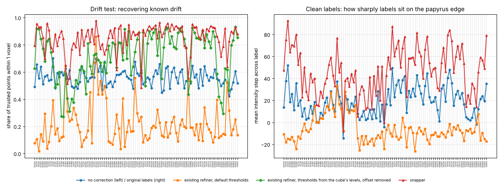
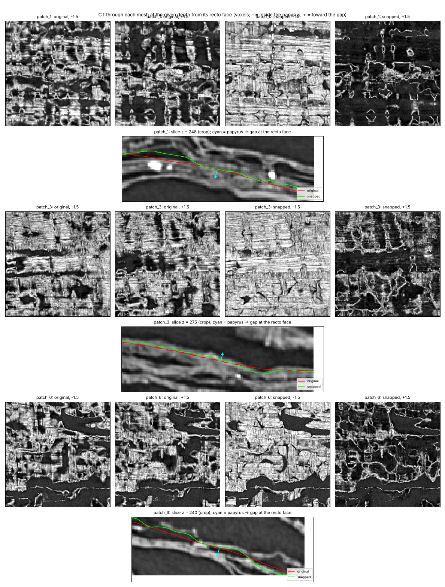

# scroll-label-snap

Moves approximate recto-surface labels in Herculaneum scroll CT back onto the real papyrus surface.

This is work in progress toward a [Vesuvius Challenge](https://scrollprize.org/prizes) progress-prize submission. It targets the "label quality" open problem in the [2026 open problems](https://scrollprize.org/2026_open_problems). Surface models are trained on hand-traced labels, and those labels drift off the surface. The organizers name this one of the main unwrapping bottlenecks and suggest "label snapping" as a fix.

## How it works

For each labeled cube:

1. **Sample the surface.** The labeled surface is sampled every ~3 voxels.
   - Normals come from the shape of the label band.
   - Each normal is oriented to point from papyrus toward the gap.
   - Orientation is made consistent along each sheet, and then across neighbouring sheets. Every wrap's recto faces the scroll centre, so neighbouring sheets should point the same way.
2. **Score candidate shifts** from −4 to +4 voxels along the normal, by adding two terms:
   - **Step edge.** A narrow step finds the edge. A wide step checks that papyrus is behind it and a real gap in front, which rejects thin cracks inside a sheet.
   - **Learned profile match.** Normalized cross-correlation with the cube's own typical cross-section at a label.
3. **Choose all shifts at once** with an exact graph cut (Ishikawa construction). It minimizes:
   - the score cost
   - an L1 smoothness term between neighbouring samples on the same sheet
   - a hard limit of 1 voxel shift difference between neighbours
   - a weak pull toward the original label
   - a penalty for moving a label outward (toward the gap) to a spot with papyrus on both sides. There the normal is probably flipped, or the label sits on the far face of a sheet, and pushing it further only buries it in the sheet (new in v2).
4. **Move the label band** along the solved shift field. Each voxel's displacement is blended from nearby samples on the same sheet, and the band is resampled with interpolation, so a moved band keeps clean edges (new in v2; v1 left stair steps). Not-annotated regions (label 2) are never changed. A per-voxel confidence map is written as well.

`scroll_label_snap/core.py` also contains a port of the existing VC3D refiner (`ObjAlphaCompRefinement`) as a baseline. `tests/test_solver.py` checks the graph cut against brute force.

## Results on the label cubes

Two sets of cubes, evaluated the same way with the default parameters (`tools/eval_folder.py`):
- **Development (20 cubes):** the cubes the method was built and tuned on. Full tables in [`results/eval_dev.md`](results/eval_dev.md).
- **Held-out (100 cubes):** other cube pairs picked at random from the bucket. The seed was fixed and pushed before any of them were downloaded, and nothing was tuned on them. Full tables in [`results/eval_heldout.md`](results/eval_heldout.md).

Per-cube numbers are in the matching `.json` files. A before/after on cube sample_00005 is in [`results/labels_before_after_00005.png`](results/labels_before_after_00005.png). It shows the three largest changes and three random slices.

### The existing refiner as a baseline

`scroll_label_snap/core.py` contains a port of VC3D's alpha-composite refiner (`ObjAlphaCompRefinement`), the refinement step that exists today. With VC3D's default opacity thresholds (118 and 165 of 255), it does worse than leaving the labels alone here. In these cubes the gap is about 50 and papyrus about 125, so the lower threshold sits just below the papyrus level and the upper one well above it. To make it a fair baseline, it is also scored in three better-set-up versions:
- **Offset removed.** The refiner works to its own convention: it puts the surface just past the first voxel above the threshold, not where these annotators draw it. Each version has its median shift on the clean labels removed.
- **Thresholds from each cube's own levels**, offset removed: the mean brightness of gap and of papyrus (the two Otsu classes). This needs no tuning.
- **The best fixed thresholds**, offset removed: the best of 13 threshold pairs on the development cubes (70 and 110). On the held-out cubes we report that pair, and also the pair that is best on the held-out cubes themselves, as the refiner's ceiling.

The offset removal uses the clean labels, which a real user wouldn't have; the snapper takes its convention from the labels it is given. With these drift fields that difference is small: on the development cubes, each field's median is within 0.15 voxels of zero.

### Drift test

Each cube's labels were pushed off the surface by a known smooth random drift (std 1.5 voxels, correlation length 40 voxels). Each method was then run on the drifted labels, and we measured how far the result lands from the original label. This is scored only at **trusted points**: places where the original label sits on a strong, unambiguous edge, so it can serve as ground truth (258,394 points in development, 717,523 held out).

| Method | Within 1 voxel: development | Within 1 voxel: held-out | Mean error (voxels): development | Mean error: held-out |
|---|---|---|---|---|
| No correction (drifted labels) | 57% | 57% | 1.12 | 1.14 |
| Existing refiner, VC3D default thresholds | 9% | 18% | 3.09 | 2.66 |
| Existing refiner, default thresholds, offset removed | 20% | 33% | 2.67 | 2.20 |
| Existing refiner, thresholds from each cube's own levels, offset removed | 80% | 78% | 0.68 | 0.73 |
| Existing refiner, best thresholds on development (70-110), offset removed | 82% | 77% | 0.64 | 0.77 |
| **Snapper** | **89%** | **88%** | **0.52** | **0.55** |

The refiner's ceiling on the held-out cubes, the pair that is best there (50-110, picked after seeing them), reaches 80% within 1 voxel (mean error 0.69).

**Consistency** is measured at all points. It asks whether correcting the drifted labels lands in the same place as correcting the clean labels.

| Within 1 voxel | Development | Held-out |
|---|---|---|
| Existing refiner, default thresholds | 61% | 63% |
| Existing refiner, thresholds from each cube's own levels | 77% | 73% |
| **Snapper** | **81%** | **75%** |

**Clean labels.** This is the intensity step across each label, papyrus side minus gap side. It is partly circular: the snapper optimizes edge strength, and the refiner also seeks an edge. The drift test is the stronger evidence.

| Papyrus on the correct side of the label | Development | Held-out |
|---|---|---|
| Original labels | 67% | 63% |
| Existing refiner, default thresholds | 35% | 45% |
| Existing refiner, thresholds from each cube's own levels, offset removed | 75% | pending |
| **Snapper** | **91%** | **86%** |



The same figure for the development cubes is [`results/eval_dev.png`](results/eval_dev.png).

What this shows:
- **Most of the refiner's poor default result is its thresholds.** Set from each cube's own levels, with its offset removed, it goes from 9% to 80% on the development cubes (18% to 78% held out). That fix is simple and needs no tuning; it may be worth having in VC3D on its own.
- **The snapper is still ahead of the best-set-up refiner on accuracy.**
  - Within 1 voxel: +9 points on the development cubes and +10 held out.
  - Mean error: 0.52 vs 0.68 voxels in development, 0.55 vs 0.73 held out.
  - Over 2 voxels: 3% vs 4% in development, 3% vs 6% held out.
  - Cube by cube it does as well or better on 19 of 20 development cubes and 94 of 100 held-out cubes. The median held-out cube gains 10 points.
- **On consistency the two are close.** The snapper is within 1 voxel of its own clean-label result more often (81% vs 77% in development, 75% vs 73% held out). Held out, it also has slightly more large differences (14% vs 12% over 2 voxels), so its mean difference is larger (1.04 vs 0.92 voxels).
- **Against no correction**, the snapper is better on 97 of the 100 held-out cubes. It is worse on three: sample_00184, sample_00186 and sample_00478.
- **Where the refiner wins.** The refiner with the cube's own levels scores higher on sample_00018 in development (72% vs 67%) and on six held-out cubes. Two of those gaps are large: sample_00478 (59% vs 49%) and sample_00639 (84% vs 79%). The other four are 2 points or less.

### Drift draws, and an earlier number

The drift is random, so per-cube numbers depend on the draw. Earlier versions of this README reported 91% within 1 voxel for the snapper on the development cubes. That run seeded cube k with k // 2 (it ran as two processes, each counting from 0); the current runs seed cube k with k, as the held-out run always did. The code is the same: with the old seeds, all 20 development cubes give exactly the old drifted labels, and sample_00002 and sample_00018 give exactly the old snapper results.

Most cubes move by a few points between draws. sample_00018, a hazy cube, goes from 93% with the old draw to 67% with the new one:
- **What happens.** With the new draw, 15% of its trusted points end more than 2 voxels off (8% for the refiner with the cube's own levels). Most of them are about 3 voxels toward the papyrus side, in many small patches, and not where the drift was largest.
- **Why.** The learned profile is the main cause. It is learned from the labels being corrected, and with this draw it favours a position inside the sheet. With the profile term off, the share more than 2 voxels off falls to 6.5% (75% within 1 voxel).
- **Next.** Learning the profile so it doesn't depend on where the input labels sit is a next step. A change like that needs a fresh held-out set, since this one has now been used.

`tools/drift_draws.py` runs both checks: `seeds` rebuilds an older run's drifted labels with a given seed scheme, and `diagnose` describes one cube's large misses under one draw. The v1-to-v2 comparison below comes from the earlier runs. We haven't confirmed that v1 used the same draws.

### The whole dataset

All 892 cube pairs in the bucket have been snapped with the v2 defaults (`tools/snap_folder.py`, 12 workers on a Ryzen AI Max+ 395). That is 116 million surface samples in 15.8 CPU-hours, about 1.3 hours of wall time. Per-cube numbers are in [`results/full_run_summary.csv`](results/full_run_summary.csv):

| Per cube | Median | 5th-95th percentile |
|---|---|---|
| Surface samples | 121,680 | 49,634-234,488 |
| Share moved by 1 voxel or more | 70% | 61-77% |
| Share flagged (label on a reversed face) | 6.9% | 2.3-17.5% |
| Mean confidence | 0.80 | 0.66-0.89 |

The most-flagged cubes are also the lowest-confidence ones: samples 00798, 00256 and 00323 have 25-34% flagged. That makes them good places for a human to look first.

### Changes since v1

From the earlier development runs, [`results/eval_v1.md`](results/eval_v1.md) and [`results/eval_v2.md`](results/eval_v2.md), with the old drift seeds:

| | v1 | v2 |
|---|---|---|
| Drift test: within 1 voxel | 87% | 91% |
| Drift test: mean error (voxels) | 0.54 | 0.46 |
| Consistency: within 1 voxel | 79% | 83% |
| Extra edge roughness of the band vs. the original labels | +11% | +6% |

- **Smooth warp.** Roughness is the number of exposed voxel faces per band voxel, over all 20 cubes (`tools/roughness.py`). Moving a band by a perfectly smooth shift still adds 2-4% from resampling, so +6% is close to that floor. See [`results/warp_v1_vs_v2.png`](results/warp_v1_vs_v2.png).
- **Inside-the-sheet guard.** On the 120 moves in the blind review, v2 puts 3 of the 8 losses back on the original label (q057, q070, q107). It leaves 90 of the 98 wins within 0.5 voxel of where v1 put them; 2 went back to the original. See [`results/review_v1_losses_v2.png`](results/review_v1_losses_v2.png); `tools/recheck_review.py` produced the per-item numbers in [`results/review_v1_items_under_v2.json`](results/review_v1_items_under_v2.json).
  - The guard only penalizes outward moves. We chose that after seeing that penalizing inward moves as well also undid 2 wins, so these review numbers are optimistic. A fresh review is the real test.
- **Drift-test inputs.** The drifted labels and the existing refiner's output now go through the smooth warp too, so their rows moved slightly from v1.

### Caveats

- **Trusted points are the easy places.** In hazy regions the picture is less clear; the blind review below covers them.
- **The refiner rows come from our port** of `ObjAlphaCompRefinement`, run on the same samples, normals and drift as the snapper. The better-set-up versions are not how VC3D runs it today. They show how much of the gap to the snapper is down to setup.

### Known failure mode

The automatic evaluation flagged hazy cubes (sample 2; samples 8, 17 and 18), where the snapper moves many clean labels 2+ voxels. The blind review found those moves are mostly right: 20 of 21 decisive answers there preferred the snapped label.

The moves the review rejected look different. In 6 of the 8 losses, the original label sits on a face whose gap is on the opposite side from the oriented normal. Either the normal is flipped there, or the label is on the far face of its sheet. v1 then pushed the label outward into papyrus. The v2 guard stops 3 of these 6; the other 3 still go into the sheet.

Of the two remaining losses, one is a small move. In the other, the snapper put the band centre on the papyrus side of the edge, which is where this cube's own labels usually sit (sample 11 places them about 1.5 voxels in). The reviewer preferred the band nearer the edge.

Compare [`results/compare_sample_00002.png`](results/compare_sample_00002.png) with [`results/compare_sample_00005.png`](results/compare_sample_00005.png) for what v1 does on a hazy and a clear cube.

### Flagged labels: which face does the label belong to?

The snapper flags a label when it sits on a clear face of the opposite polarity (papyrus on the +n side, gap on the −n side) and no face of the expected polarity is within ±4 voxels. That is 3–19% of samples per cube (median 7%); sample 2 is the highest. The flags are written to `OUT_DIR/flags/` next to the labels.

The flag can't be turned into an automatic fix, because the scan alone can't say which face such a label belongs to. Two different situations look identical locally:
- **Far face:** the label is on the far face of its own sheet. It should stay on the face it's on.
- **Crossed gap:** the label has drifted across the gap onto the next sheet. It should move back.

The blind reviews show both. Of the 196 moved items across the two reviews, the flag caught:
- 7 of the 15 where the reviewer preferred the original
- 7 of the 18 marked "can't tell"
- only 11 of the 161 where they preferred the snapped label

So flagging about 7% of labels points a human at half the losses. This matches the "humans correct only the uncertain regions" idea in the open problems.

`Params(face_polarity=True)` snaps flagged labels onto the face they're on instead of searching along +n. At the reviewed points this keeps all 7 flagged losses within 1.5 voxels of the original. It also pulls back 10 of the 11 flagged wins, which the reviewers preferred moved, so it is off by default and the default output is unchanged from v2. The per-item positions are in [`results/reversed_face_check.json`](results/reversed_face_check.json).

## Snapping traced meshes (VC3D tifxyz)

The same scores and graph cut also snap a traced VC3D surface. A tifxyz grid has vertices about 20 voxels apart. It is densified to about 3-voxel samples, which are snapped and then fit back onto the original grid. The normals come from the grid. Which side is recto comes from the scroll's geometry, because every wrap's recto faces the scroll centre. Each mesh keeps its own offset from the papyrus face. Details are in [`results/mesh_w035.md`](results/mesh_w035.md).

It was developed on segment w035 of PHerc. 0139 at 9.362 µm, the one in the scrollprize.org ink tutorial, using 8 random patches of 24 × 24 vertices. It was then tested on a held-out segment, w052, a different wrap on the same scan. That test was set out before the data was downloaded, and nothing was tuned on it ([`results/mesh_w052.md`](results/mesh_w052.md)).

| | w035 (development) | w052 (held out) |
|---|---|---|
| Papyrus on the recto side of the face: original → snapped | 55% → 88% | 70% → 93% |
| Drift test, within 1 voxel: no correction → snapper | 70% → **90%** | 69% → **94%** |
| VC3D refiner, thresholds tuned on the same patches, offset removed | 61% | 68% |
| VC3D refiner, thresholds from each patch's own gap and papyrus levels, offset removed | 57% | 70% |
| Snapping onto the m7 surface prediction (the PHerc. 343 winner's method), offset removed | 41% | 63% |
| Consistency: snapper / refiner with each patch's own levels / m7 snapping | 84% / 75% / 69% | 90% / 84% / 76% |
| Fibre check, patches with the recto signature: snapped / original / m7 snapping | 8 / 5 / 7 of 8 | 8 / 6 / 6 of 8 |

The w035 results are below.

- **Where the original mesh sits.** Read at its own typical face position, the original mesh has papyrus on the recto side at only 55% of samples. After snapping, 88%.
- **Drift test on w035.** Known smooth drifts were applied to the mesh vertices. At 15,324 trusted samples, the share within 1 voxel of the original position went:

| Method | Within 1 voxel (drift std 1.5, corr. 40) | Within 1 voxel (drift std 2.0, corr. 80) |
|---|---|---|
| No correction | 70% | 42% |
| VC3D alpha-composite refiner, thresholds tuned on these patches, offset removed | 61% | 57% |
| **Snapper** | **90%** | **90%** |



Each patch shows the CT read through the original and the snapped mesh, just inside and just outside the recto face, plus a cross-section.

**Fibre check.** Recto fibres run around the scroll and verso fibres along its axis. So under a surface on a recto face, the fibre direction should turn from across the axis to along it, going deeper into the papyrus. `tools/fibre_check.py` measures this, independently of the snapper's scores.
- **Snapped surface:** shows the pattern in 8 of 8 patches.
- **Original mesh:** 5 of 8, with near-zero size.
- **Control snapped onto the opposite faces:** 4 of 8.

So the snapper lands on recto faces. The effect is small but consistent. See [`results/fibre_w035.png`](results/fibre_w035.png).

**Review flags.** 15% of samples stop at the ±4-voxel search limit (`snap_limit`), and 10.5% sit on a reversed face (`snap_flag`). On the input grid, `snap_review` marks the 17% of vertices where most of the surrounding surface is flagged.

**Open question.** At this resolution, sheets are often thin layers packed into bundles. Where two recto faces lie within ±4 voxels of a wandering trace, neither the drift test nor the fibre check can say which sheet the tracer meant. That needs expert review, or a downstream check such as ink detection on renders of both meshes.

Whether a cleaner surface reads better is not yet measured. The PHerc. 306B winners found that snapping to CT density peaks, after snapping to m7, did not make their letters more legible.

```bash
pip install "zarr>=2.16,<3" fsspec aiohttp requests        # to read the scan from the open-data bucket
python tools/fetch_segment.py segments/w035 --segment <tifxyz URL> --volume <OME-Zarr URL> --patches 8
python tools/snap_tifxyz.py snapped segments/w035/patch_*   # snapped.tifxyz (same grid) + snapped_dense.tifxyz
python tools/eval_mesh.py out/eval_mesh.json segments/w035/patch_*
python tools/render_mesh.py out/render.png snapped segments/w035/patch_1 --sections
python tools/fibre_check.py out/fibre.json segments/w035/patch_* --snapped snapped --png out/fibre.png
python tools/snap_to_prediction.py snapped_m7 segments/w035/patch_*   # baseline: snap onto a surface prediction (fetch with --extra m7=URL)
```

## Setup

```bash
pip install -r requirements.txt
```

## Usage

```bash
# one or more cubes
python tools/snap_cube.py OUT_DIR images/sample_00001.tif labels/sample_00001.tif

# a whole folder laid out like the dataset (images/ + labels/), in parallel; resumable
# writes labels/, confidence/ and flags/ (labels that may be on the wrong face)
python tools/snap_folder.py IN_DIR OUT_DIR --workers 12

# evaluation, summary and before/after close-ups
python tools/eval_snap.py out/eval.json images/sample_00001.tif labels/sample_00001.tif
python tools/summarize_eval.py out/summary out/eval.json
python tools/render_compare.py out/cmp.png images/X.tif labels/X.tif OUT_DIR/labels/X.tif z
```

Each worker needs about 3 GB of RAM. A 320³ cube takes 30–120 s per core.

### Windows

```bat
git clone https://github.com/aqsnyder/scroll-label-snap
cd scroll-label-snap
python -m venv .venv
.venv\Scripts\activate
pip install -r requirements.txt
python tools\snap_folder.py D:\vesuvius\kaggle D:\vesuvius\snapped --workers 12
```

## Data

The tools run on the Vesuvius Challenge surface-label cubes ([Hugging Face bucket](https://huggingface.co/buckets/scrollprize/datasets/tree/surfaces/kaggle)): `images/sample_NNNNN.tif` paired with `labels/sample_NNNNN.tif`. Each cube is 320³ uint8.

| Label value | Meaning |
|---|---|
| 0 | annotated background |
| 1 | recto surface |
| 2 | not annotated |

The data is licensed CC BY-NC 4.0 and is not included here. The example images in `results/` are crops of that data. The mesh figures are renders of segment w035 and its scan from the [Vesuvius Challenge open data](https://scrollprize.org/data), also CC BY-NC 4.0.

## Blind human review

The automatic tests can't say whether a big move on a hazy cube is a fix or a mistake, so a
person judges a sample by eye without knowing which label is which.

- `tools/make_review.py` picks, per cube, 3 points where the snapper moved the label by 2+
  voxels, 3 where it moved 1-2 voxels and 1 where it didn't move (a control), spread at least
  32 voxels apart: 140 comparisons. It adds 14 catch items, where the original label is
  compared with itself pushed 3 voxels into the gap or 2.5 voxels into the sheet, at points
  where the snapper and the original agree; a reviewer who can't spot those can't be trusted
  on the rest.
- Each item shows a 48 x 48 voxel slice, cut perpendicular to the axis closest to the surface,
  with a zoomed-out context view and the two candidates side by side. Item order is shuffled,
  and exactly half the comparisons (and half the catch items) put each candidate on the left.
- The reviewer answers "A is better", "B is better", "About the same" or "Can't tell"
  (`review/index.html`). The page shows only item ids and images; the answer key stays
  with whoever runs the review until the answers are in.
- `tools/score_review.py` unblinds the answers and reports preferences per stratum, for the
  hazy cubes, by direction of the move and per cube, with an exact sign test, catch
  accuracy, left/right bias and answer times.

```bash
python tools/make_review.py review/ out/review_key.json data/images data/labels out/labels --seed 0
python tools/score_review.py out/review_key.json answers.json results/review_v1.md
```

The first review set is `32989576ca01`. Its answer key was sealed before any answers came in:
the SHA-256 of the key (as `json.dumps(key, sort_keys=True)`) is
`32989576ca01fe3ce79d7ab8491025ed9730d72ac8529d673898dc4182edcb28`, and an encrypted copy is
`review/sealed_key_32989576ca01.enc` (AES-256-CBC, `openssl enc -pbkdf2 -iter 200000`). The
key, the passphrase and the answers are now in `results/`.

### Result of review v1 ([`results/review_v1.md`](results/review_v1.md))

Where the snapper moved the label, the reviewer preferred the snapped label 98 times and the
original 8 times. That is 92% of decisive answers (95% CI 86-96%); 14 of 120 were "about the
same" or "can't tell". Big moves (2+ voxels) went 47 to 6 and moderate moves (1-2 voxels) 51
to 2. The hazy cubes flagged by the automatic evaluation went 20 to 1, so the large moves there
are mostly fixes, not mistakes.

Five of the eight losses put the label inside a thick sheet instead of on its face. Caveats:
- One reviewer, who owns this repo.
- The snapped band's stair-step edge can give it away.
- The controls and catch items were only clean at the centre point of each 48-voxel window.

### Review v2 (set `af7d4c85d7f6`)

Built with `tools/make_review_v2.py --seed 1` on the v2 output, for a reviewer who did not work on the tool:
- **Fresh points.** No item is within 32 voxels of a v1 item.
- **111 items:**
  - 40 big moves and 40 moderate moves (2 of each per cube).
  - 15 controls, where the two labels agree across the whole window (IoU 0.80 or more), not just at its centre.
  - 16 catch items: the original label pushed 3 voxels into the gap or 2.5 voxels into the sheet, 8 each way. They are only used where both labels agree across the window and the scan confirms the push direction: a dark gap in front, or bright papyrus behind.
- **A short tutorial first:** worked examples (good, too far out, too far in) and 4 practice items that show the right answer after each pick.
- **Per-reviewer storage.** Answers are stored under each reviewer's name, so several people can take the same set.
- **Sealed key.** The SHA-256 of the answer key is `af7d4c85d7f6f07106839d0af2de42655095ba677316cb9c3ae9ddec95dc08f6`, and an encrypted copy is `review/sealed_key_af7d4c85d7f6.enc`. The page is `review/v2/index.html`.

### Result of review v2 ([`results/review_v2.md`](results/review_v2.md))

A second reviewer, who did not work on the tool and had never seen these scans, judged the v2 output on fresh items:
- **Moves:** where the snapper moved the label, she preferred the snapped label 63 times and the original 7 times. That is 90% of decisive answers (95% CI 81-95%); 10 of 80 were "about the same" or "can't tell".
- **Big moves (2+ voxels)** went 27 to 6; **moderate moves (1-2 voxels)** 36 to 1; **the hazy cubes** 12 to 1.
- **Checks:** she got all 16 catch items and all 4 practice items right. She rated 11 of the 15 controls "about the same".
- **Losses:** four of the seven are the same failure mode found in review v1, where the label sits on a face whose gap is opposite the normal.

## Next steps

1. **Decide flagged labels with more context.** Following each sheet over a larger area, or using the traced mesh's own history, could tell which face a flagged label belongs to. Until then, flagged labels are the place for human review.
2. **Use the confidence map:** leave or flag low-confidence regions instead of moving them.
3. **Make the learned profile independent of the input labels** (see "Drift draws" above), then test it on a fresh held-out set of cubes.
4. **Meshes: check which layer is right.** Get expert review of the snapped w035 patches. Compare ink detection on renders of the original and snapped mesh.
5. **Meshes: whole segments.** `tools/snap_segment.py` snaps a whole segment tile by tile, streaming the scan; the first full run, on w035, is next.
