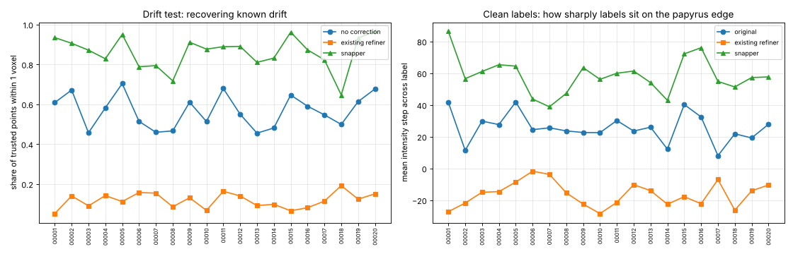

# scroll-label-snap

Moves approximate recto-surface labels in Herculaneum scroll CT back onto the real papyrus surface.

This is work in progress toward a [Vesuvius Challenge](https://scrollprize.org/prizes) progress-prize submission. It targets the "label quality" open problem in the [2026 open problems](https://scrollprize.org/2026_open_problems). Surface models are trained on hand-traced labels, and those labels drift off the surface. The organizers name this one of the main unwrapping bottlenecks and suggest "label snapping" as a fix.

## How it works

For each labeled cube:

1. **Sample the surface.** The labeled surface is sampled every ~3 voxels.
   - Normals come from the shape of the label band.
   - Each normal is oriented to point from papyrus toward the gap.
   - Orientation is made consistent along each sheet, and then across neighbouring sheets. Every wrap's recto faces the scroll centre, so neighbouring sheets should point the same way.
2. **Score candidate shifts** from −4 to +4 voxels along the normal, by adding two terms:
   - **Step edge.** A narrow step finds the edge. A wide step checks that papyrus is behind it and a real gap in front, which rejects thin cracks inside a sheet.
   - **Learned profile match.** Normalized cross-correlation with the cube's own typical cross-section at a label.
3. **Choose all shifts at once** with an exact graph cut (Ishikawa construction). It minimizes:
   - the score cost
   - an L1 smoothness term between neighbouring samples on the same sheet
   - a hard limit of 1 voxel shift difference between neighbours
   - a weak pull toward the original label
4. **Move the label band** along the solved shift field. Not-annotated regions (label 2) are never changed. A per-voxel confidence map is written as well.

`scroll_label_snap/core.py` also contains a port of the existing VC3D refiner (`ObjAlphaCompRefinement`) as a baseline. `tests/test_solver.py` checks the graph cut against brute force.

## Results (20 cubes, ~2.5 million surface points)

These are the full results in [`results/eval_v1.md`](results/eval_v1.md), with per-cube numbers in [`results/eval_v1.json`](results/eval_v1.json). They come from `tools/eval_snap.py` with the default parameters.



**Drift test.** Each cube's labels were pushed off the surface by a known smooth random drift (std 1.5 voxels, correlation length 40 voxels). Each method was then run on the drifted labels, and we measured how far the result lands from the original label. This is scored only at **trusted points**: places where the original label sits on a strong, unambiguous edge, so it can serve as ground truth (258,394 points).

| Method | Mean error (voxels) | Within 1 voxel | Over 2 voxels |
|---|---|---|---|
| No correction (drifted labels) | 1.10 | 57% | 16% |
| Existing refiner (alpha-composite port) | 2.88 | 11% | 70% |
| **Snapper** | **0.54** | **87%** | **3%** |

**Consistency** is measured at all points. It asks whether correcting the drifted labels lands in the same place as correcting the clean labels. The snapper is within 1 voxel at 79% of points; the existing refiner at 60%.

**Clean labels.** This is the intensity step across each label, papyrus side minus gap side. Higher means the label sits more sharply on the papyrus edge.

| Labels | Step across label | Papyrus on the correct side |
|---|---|---|
| Original | 25.7 | 67% |
| Existing refiner | −16.2 | 36% |
| **Snapper** | **58.6** | **92%** |

### Caveats

- **The clean-label table is partly circular**, because the snapper optimizes edge strength. The drift test is the stronger evidence.
- **Trusted points are the easy places.** In hazy regions the picture is less clear.
- **The existing refiner's numbers depend on its fixed thresholds** (tuned for other volumes) and on its convention of moving 1 voxel past the first material hit. It is not a like-for-like competitor on this data. It is included because it is the refinement step that exists today.

### Known failure mode

On some cubes the snapper moves many clean labels 2+ voxels into the sheet or into the gap. Sample 2 is the clearest case; samples 8, 17 and 18 show lower consistency. Compare [`results/compare_sample_00002.png`](results/compare_sample_00002.png) with the good case [`results/compare_sample_00005.png`](results/compare_sample_00005.png).

Our reading draws on the [scroll anatomy notes](https://github.com/ScrollPrize/villa/blob/main/SCROLL_ANATOMY.md). In hazy scans, phase-contrast halos, or the boundary between a sheet's two fiber layers, can look more like an edge than the true outer face. Two experimental options did not fix it:
- `calibrate`: removes any cube-wide offset.
- `stay_bonus`: a "do no harm" bonus for staying put.

Both are off by default. A blind human review is the next step to settle which moves are right.

## Setup

```bash
pip install -r requirements.txt
```

## Usage

```bash
# one or more cubes
python tools/snap_cube.py OUT_DIR images/sample_00001.tif labels/sample_00001.tif

# a whole folder laid out like the dataset (images/ + labels/), in parallel; resumable
python tools/snap_folder.py IN_DIR OUT_DIR --workers 12

# evaluation, summary and before/after close-ups
python tools/eval_snap.py out/eval.json images/sample_00001.tif labels/sample_00001.tif
python tools/summarize_eval.py out/summary out/eval.json
python tools/render_compare.py out/cmp.png images/X.tif labels/X.tif OUT_DIR/labels/X.tif z
```

Each worker needs about 3 GB of RAM. A 320³ cube takes 30–70 s per core.

### Windows

```bat
git clone https://github.com/aqsnyder/scroll-label-snap
cd scroll-label-snap
python -m venv .venv
.venv\Scripts\activate
pip install -r requirements.txt
python tools\snap_folder.py D:\vesuvius\kaggle D:\vesuvius\snapped --workers 12
```

## Data

The tools run on the Vesuvius Challenge surface-label cubes ([Hugging Face bucket](https://huggingface.co/buckets/scrollprize/datasets/tree/surfaces/kaggle)): `images/sample_NNNNN.tif` paired with `labels/sample_NNNNN.tif`. Each cube is 320³ uint8.

| Label value | Meaning |
|---|---|
| 0 | annotated background |
| 1 | recto surface |
| 2 | not annotated |

The data is licensed CC BY-NC 4.0 and is not included here. The example images in `results/` are crops of that data.

## Blind human review

The automatic tests can't say whether a big move on a hazy cube is a fix or a mistake, so a
person judges a sample by eye without knowing which label is which.

- `tools/make_review.py` picks, per cube, 3 points where the snapper moved the label by 2+
  voxels, 3 where it moved 1-2 voxels and 1 where it didn't move (a control), spread at least
  32 voxels apart: 140 comparisons. It adds 14 catch items, where the original label is
  compared with itself pushed 3 voxels into the gap or 2.5 voxels into the sheet, at points
  where the snapper and the original agree; a reviewer who can't spot those can't be trusted
  on the rest.
- Each item shows a 48 x 48 voxel slice, cut perpendicular to the axis closest to the surface,
  with a zoomed-out context view and the two candidates side by side. Item order is shuffled,
  and exactly half the comparisons (and half the catch items) put each candidate on the left.
- The reviewer answers "A is better", "B is better", "About the same" or "Can't tell"
  (`review/index.html`). The page shows only item ids and images; the answer key stays
  with whoever runs the review until the answers are in.
- `tools/score_review.py` unblinds the answers and reports preferences per stratum, for the
  hazy cubes, by direction of the move and per cube, with an exact sign test, catch
  accuracy, left/right bias and answer times.

```bash
python tools/make_review.py review/ review/key.json data/images data/labels out/labels --seed 0
python tools/score_review.py review/key.json answers.json results/review_v1.md
```

## Next steps

1. **Finish the blind review** (above) and use it to decide how to handle hazy cubes.
2. **Use the confidence map:** leave or flag low-confidence regions instead of moving them.
3. **Snap traced meshes.** Apply the same snapping to traced meshes (tifxyz) so it can be used in VC3D.
