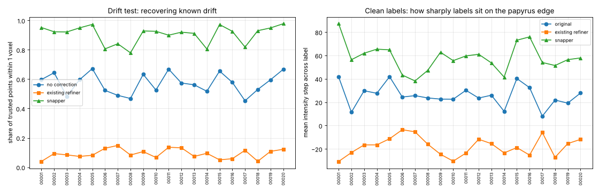

# scroll-label-snap

Moves approximate recto-surface labels in Herculaneum scroll CT back onto the real papyrus surface.

This is work in progress toward a [Vesuvius Challenge](https://scrollprize.org/prizes) progress-prize submission. It targets the "label quality" open problem in the [2026 open problems](https://scrollprize.org/2026_open_problems). Surface models are trained on hand-traced labels, and those labels drift off the surface. The organizers name this one of the main unwrapping bottlenecks and suggest "label snapping" as a fix.

## How it works

For each labeled cube:

1. **Sample the surface.** The labeled surface is sampled every ~3 voxels.
   - Normals come from the shape of the label band.
   - Each normal is oriented to point from papyrus toward the gap.
   - Orientation is made consistent along each sheet, and then across neighbouring sheets. Every wrap's recto faces the scroll centre, so neighbouring sheets should point the same way.
2. **Score candidate shifts** from −4 to +4 voxels along the normal, by adding two terms:
   - **Step edge.** A narrow step finds the edge. A wide step checks that papyrus is behind it and a real gap in front, which rejects thin cracks inside a sheet.
   - **Learned profile match.** Normalized cross-correlation with the cube's own typical cross-section at a label.
3. **Choose all shifts at once** with an exact graph cut (Ishikawa construction). It minimizes:
   - the score cost
   - an L1 smoothness term between neighbouring samples on the same sheet
   - a hard limit of 1 voxel shift difference between neighbours
   - a weak pull toward the original label
   - a penalty for moving a label outward (toward the gap) to a spot with papyrus on both sides. There the normal is probably flipped, or the label sits on the far face of a sheet, and pushing it further only buries it in the sheet (new in v2).
4. **Move the label band** along the solved shift field. Each voxel's displacement is blended from nearby samples on the same sheet, and the band is resampled with interpolation, so a moved band keeps clean edges (new in v2; v1 left stair steps). Not-annotated regions (label 2) are never changed. A per-voxel confidence map is written as well.

`scroll_label_snap/core.py` also contains a port of the existing VC3D refiner (`ObjAlphaCompRefinement`) as a baseline. `tests/test_solver.py` checks the graph cut against brute force.

## Results (v2, 20 cubes, ~2.5 million surface points)

These are the full results in [`results/eval_v2.md`](results/eval_v2.md), with per-cube numbers in [`results/eval_v2.json`](results/eval_v2.json). They come from `tools/eval_snap.py` with the default parameters. The v1 numbers are in [`results/eval_v1.md`](results/eval_v1.md).



**Drift test.** Each cube's labels were pushed off the surface by a known smooth random drift (std 1.5 voxels, correlation length 40 voxels). Each method was then run on the drifted labels, and we measured how far the result lands from the original label. This is scored only at **trusted points**: places where the original label sits on a strong, unambiguous edge, so it can serve as ground truth (258,394 points).

| Method | Mean error (voxels) | Within 1 voxel | Over 2 voxels |
|---|---|---|---|
| No correction (drifted labels) | 1.10 | 58% | 14% |
| Existing refiner (alpha-composite port) | 3.09 | 9% | 75% |
| **Snapper** | **0.46** | **91%** | **1%** |

**Consistency** is measured at all points. It asks whether correcting the drifted labels lands in the same place as correcting the clean labels. The snapper is within 1 voxel at 83% of points; the existing refiner at 61%.

**Clean labels.** This is the intensity step across each label, papyrus side minus gap side. Higher means the label sits more sharply on the papyrus edge.

| Labels | Step across label | Papyrus on the correct side |
|---|---|---|
| Original | 25.7 | 67% |
| Existing refiner | −17.8 | 35% |
| **Snapper** | **58.4** | **91%** |

### Changes since v1

| | v1 | v2 |
|---|---|---|
| Drift test: within 1 voxel | 87% | 91% |
| Drift test: mean error (voxels) | 0.54 | 0.46 |
| Consistency: within 1 voxel | 79% | 83% |
| Extra edge roughness of the band vs. the original labels | +11% | +6% |

- **Smooth warp.** Roughness is the number of exposed voxel faces per band voxel, over all 20 cubes (`tools/roughness.py`). Moving a band by a perfectly smooth shift still adds 2-4% from resampling, so +6% is close to that floor. See [`results/warp_v1_vs_v2.png`](results/warp_v1_vs_v2.png).
- **Inside-the-sheet guard.** On the 120 moves in the blind review, v2 puts 3 of the 8 losses back on the original label (q057, q070, q107). It leaves 90 of the 98 wins within 0.5 voxel of where v1 put them; 2 went back to the original. See [`results/review_v1_losses_v2.png`](results/review_v1_losses_v2.png); `tools/recheck_review.py` produced the per-item numbers in [`results/review_v1_items_under_v2.json`](results/review_v1_items_under_v2.json).
  - The guard only blocks outward moves. We chose that after seeing that blocking inward moves as well also undid 2 wins, so these review numbers are optimistic. A fresh review is the real test.
- **Drift-test inputs.** The drifted labels and the existing refiner's output now go through the smooth warp too, so their rows moved slightly from v1.

### Caveats

- **The clean-label table is partly circular**, because the snapper optimizes edge strength. The drift test is the stronger evidence.
- **Trusted points are the easy places.** In hazy regions the picture is less clear; the blind review below covers them.
- **The existing refiner's numbers depend on its fixed thresholds** (tuned for other volumes) and on its convention of moving 1 voxel past the first material hit. It is not a like-for-like competitor on this data. It is included because it is the refinement step that exists today.

### Known failure mode

The automatic evaluation flagged hazy cubes (sample 2; samples 8, 17 and 18), where the snapper moves many clean labels 2+ voxels. The blind review found those moves are mostly right: 20 of 21 decisive answers there preferred the snapped label.

The moves the review rejected look different. In 6 of the 8 losses, the original label sits on a face whose gap is on the opposite side from the oriented normal. Either the normal is flipped there, or the label is on the far face of its sheet. v1 then pushed the label outward into papyrus. The v2 guard stops 3 of these 6; the other 3 still go into the sheet.

Of the two remaining losses, one is a small move. In the other, the snapper put the band centre on the papyrus side of the edge, which is where this cube's own labels usually sit (sample 11 places them about 1.5 voxels in). The reviewer preferred the band nearer the edge.

Compare [`results/compare_sample_00002.png`](results/compare_sample_00002.png) with [`results/compare_sample_00005.png`](results/compare_sample_00005.png) for what v1 does on a hazy and a clear cube.

## Setup

```bash
pip install -r requirements.txt
```

## Usage

```bash
# one or more cubes
python tools/snap_cube.py OUT_DIR images/sample_00001.tif labels/sample_00001.tif

# a whole folder laid out like the dataset (images/ + labels/), in parallel; resumable
python tools/snap_folder.py IN_DIR OUT_DIR --workers 12

# evaluation, summary and before/after close-ups
python tools/eval_snap.py out/eval.json images/sample_00001.tif labels/sample_00001.tif
python tools/summarize_eval.py out/summary out/eval.json
python tools/render_compare.py out/cmp.png images/X.tif labels/X.tif OUT_DIR/labels/X.tif z
```

Each worker needs about 3 GB of RAM. A 320³ cube takes 30–120 s per core.

### Windows

```bat
git clone https://github.com/aqsnyder/scroll-label-snap
cd scroll-label-snap
python -m venv .venv
.venv\Scripts\activate
pip install -r requirements.txt
python tools\snap_folder.py D:\vesuvius\kaggle D:\vesuvius\snapped --workers 12
```

## Data

The tools run on the Vesuvius Challenge surface-label cubes ([Hugging Face bucket](https://huggingface.co/buckets/scrollprize/datasets/tree/surfaces/kaggle)): `images/sample_NNNNN.tif` paired with `labels/sample_NNNNN.tif`. Each cube is 320³ uint8.

| Label value | Meaning |
|---|---|
| 0 | annotated background |
| 1 | recto surface |
| 2 | not annotated |

The data is licensed CC BY-NC 4.0 and is not included here. The example images in `results/` are crops of that data.

## Blind human review

The automatic tests can't say whether a big move on a hazy cube is a fix or a mistake, so a
person judges a sample by eye without knowing which label is which.

- `tools/make_review.py` picks, per cube, 3 points where the snapper moved the label by 2+
  voxels, 3 where it moved 1-2 voxels and 1 where it didn't move (a control), spread at least
  32 voxels apart: 140 comparisons. It adds 14 catch items, where the original label is
  compared with itself pushed 3 voxels into the gap or 2.5 voxels into the sheet, at points
  where the snapper and the original agree; a reviewer who can't spot those can't be trusted
  on the rest.
- Each item shows a 48 x 48 voxel slice, cut perpendicular to the axis closest to the surface,
  with a zoomed-out context view and the two candidates side by side. Item order is shuffled,
  and exactly half the comparisons (and half the catch items) put each candidate on the left.
- The reviewer answers "A is better", "B is better", "About the same" or "Can't tell"
  (`review/index.html`). The page shows only item ids and images; the answer key stays
  with whoever runs the review until the answers are in.
- `tools/score_review.py` unblinds the answers and reports preferences per stratum, for the
  hazy cubes, by direction of the move and per cube, with an exact sign test, catch
  accuracy, left/right bias and answer times.

```bash
python tools/make_review.py review/ out/review_key.json data/images data/labels out/labels --seed 0
python tools/score_review.py out/review_key.json answers.json results/review_v1.md
```

The first review set is `32989576ca01`. Its answer key was sealed before any answers came in:
the SHA-256 of the key (as `json.dumps(key, sort_keys=True)`) is
`32989576ca01fe3ce79d7ab8491025ed9730d72ac8529d673898dc4182edcb28`, and an encrypted copy is
`review/sealed_key_32989576ca01.enc` (AES-256-CBC, `openssl enc -pbkdf2 -iter 200000`). The
key, the passphrase and the answers are now in `results/`.

### Result of review v1 ([`results/review_v1.md`](results/review_v1.md))

Where the snapper moved the label, the reviewer preferred the snapped label 98 times and the
original 8 times. That is 92% of decisive answers (95% CI 86-96%); 14 of 120 were "about the
same" or "can't tell". Big moves (2+ voxels) went 47 to 6 and moderate moves (1-2 voxels) 51
to 2. The hazy cubes flagged by the automatic evaluation went 20 to 1, so the large moves there
are mostly fixes, not mistakes.

Five of the eight losses put the label inside a thick sheet instead of on its face. Caveats:
- One reviewer, who owns this repo.
- The snapped band's stair-step edge can give it away.
- The controls and catch items were only clean at the centre point of each 48-voxel window.

### Review v2 (set `af7d4c85d7f6`, in progress)

Built with `tools/make_review_v2.py --seed 1` on the v2 output, for a reviewer who did not work on the tool:
- **Fresh points.** No item is within 32 voxels of a v1 item.
- **111 items:**
  - 40 big moves and 40 moderate moves (2 of each per cube).
  - 15 controls, where the two labels agree across the whole window (IoU 0.80 or more), not just at its centre.
  - 16 catch items: the original label pushed 3 voxels into the gap or 2.5 voxels into the sheet, 8 each way. They are only used where both labels agree across the window and the scan confirms the push direction: a dark gap in front, or bright papyrus behind.
- **A short tutorial first:** worked examples (good, too far out, too far in) and 4 practice items that show the right answer after each pick.
- **Per-reviewer storage.** Answers are stored under each reviewer's name, so several people can take the same set.
- **Sealed key.** The SHA-256 of the answer key is `af7d4c85d7f6f07106839d0af2de42655095ba677316cb9c3ae9ddec95dc08f6`, and an encrypted copy is `review/sealed_key_af7d4c85d7f6.enc`. The page is `review/v2/index.html`.

## Next steps

1. **Finish review v2** with an independent reviewer and score it.
2. **Better orientation where a label sits on the far face of a sheet**, the cause of most of the remaining losses.
3. **Use the confidence map:** leave or flag low-confidence regions instead of moving them.
4. **Snap traced meshes.** Apply the same snapping to traced meshes (tifxyz) so it can be used in VC3D.
