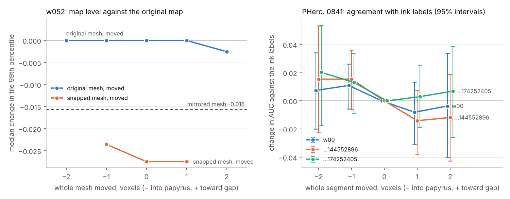

# Depth diagnostic: a uniform shift barely matters, the snapper's varying moves do

This was planned in [`depth_sweep_plan.md`](depth_sweep_plan.md), pushed at a91ef05 before any of these maps existed. It ran on 3–4 November 2026 with the ink test's model (`ink_9um` seed 42), settings and layer direction. The score files are in [`depth_sweep/`](depth_sweep/).

The w052 measures describe the ink map's level, tile by tile: how strong the map is. They are not a measure of legibility.

## Summary

- **The window check passed.** Reading the layer stack with d = 0 reproduced the earlier maps exactly, on w035 and on all three PHerc. 0841 segments.
- **Moving the whole surface 1–2 voxels barely changes the map level.**
  - On w052, the median tile change in the 99th percentile was 0.000 at d = −2, −1 and +1, and −0.003 at +2. Snapping gave −0.027.
  - The maps do change (r = 0.84–0.94 with the original), but about as many tiles gain as lose. At ±2 voxels, 35–37% of tiles lose more than 0.02 and 29–32% gain as much. Snapping: 53% lose, 24% gain.
  - The rule fixed in advance reads this as "partly", because the share losing at ±2 voxels is just over its 35% line. The medians say a uniform shift reshuffles the map rather than lowering it.
  - On PHerc. 0841, no shift made a detectable difference to agreement with the ink labels. Moving into the papyrus raised the AUC slightly on all three segments (pooled +0.013 at −1 and +0.014 at −2); moving toward the gap lowered it slightly (−0.006 and −0.002).
  - On w035, the AUC stayed between 0.9969 and 0.9979.
- **The direction of the snapper's moves matters, and the two scrolls disagree.**
  - **w052:** the mirrored mesh lowered the map level less than the snapped one (median −0.016 against −0.027). By the rule fixed in advance, the snapper's moves point the wrong way for this model. The margin is small: 0.012 against a threshold of 0.01.
  - **PHerc. 0841:** at the mirrored depth, all three traced segments lost 0.06–0.07 AUC against the labels (pooled −0.068); at the snapped depth there was no detectable loss (pooled +0.011). Mirrored minus snapped was −0.077 and −0.092, intervals excluding 0, and −0.063, whose interval just includes 0. So here the snapper's moves point the right way on average.
- **What remains is the shape of the moves.**
  - The snapped and mirrored w052 meshes move each vertex 1.95 voxels on average along its normal (median 1.69), varying from place to place, with almost no net offset (0.05 voxels).
  - They change the map about twice as much as a uniform 2-voxel shift (r = 0.71 and 0.68, against 0.84–0.85).
- **Moving the snapped mesh doesn't help.** Moved a voxel either way, it loses about as much as before: median −0.024 and −0.027 against the original map, with 52–53% of tiles losing. Against the snapped map itself, the move only reshuffles tiles, as on the original (r = 0.94–0.95, median 0.000).

## w052: each map against the original

There are 66,401,232 pixels valid in the original, snapped and mirrored renders, in 1019 tiles.

| Map | r with the original | Whole-map mean | Whole-map 99th percentile | Median tile change (99th percentile) | Tiles losing / gaining more than 0.02 |
|---|---|---|---|---|---|
| Original | 1 | 0.319 | 0.749 | | |
| Moved −2 voxels | 0.854 | 0.318 | 0.749 | 0.000 | 35% / 32% |
| Moved −1 voxel | 0.938 | 0.319 | 0.749 | 0.000 | 27% / 26% |
| Moved +1 voxel | 0.934 | 0.319 | 0.749 | 0.000 | 28% / 26% |
| Moved +2 voxels | 0.840 | 0.318 | 0.745 | −0.003 | 37% / 29% |
| **Snapped** (the ink test) | 0.714 | 0.305 | 0.722 | **−0.027** | **53% / 24%** |
| **Mirrored** | 0.684 | 0.310 | 0.733 | **−0.016** | **47% / 29%** |
| Snapped, moved −1 voxel | 0.706 | 0.305 | 0.722 | −0.024 | 52% / 25% |
| Snapped, moved +1 voxel | 0.708 | 0.305 | 0.725 | −0.027 | 53% / 25% |

The last two rows were computed here with the same code (`tools/depth_sweep.py` at a91ef05) and the same valid pixels, because the script's final comparison exited early. On the rows the script did write, this recomputation gives exactly the script's numbers.

The probabilities run from about 0.25 to 0.75. The maps are stored in steps of 1/255 (0.004), so many tiles' 99th percentile doesn't change at all.

## w035 against its ink labels

The labels were drawn on a render of the original mesh, and the model was trained on them, so this is biased toward d = 0.

| Moved (voxels) | −2 | −1 | 0 | +1 | +2 |
|---|---|---|---|---|---|
| AUC | 0.9977 | 0.9978 | 0.9979 | 0.9979 | 0.9969 |
| Best F1 | 0.9671 | 0.9681 | 0.9686 | 0.9677 | 0.9615 |

The maps behave like w052's: r = 0.85–0.94 with the original, and a median tile change of 0.000 at every shift. Tiles lose and gain about equally, 23–30% losing and 20–32% gaining more than 0.02.

## PHerc. 0841 against the ink labels

These are AUC differences with 95% block-bootstrap intervals. Bold marks an interval that excludes 0.

**The traced segments, moved:**

| Target | −2 voxels | −1 voxel | +1 voxel | +2 voxels |
|---|---|---|---|---|
| w00 | +0.007 (−0.020 to +0.034) | +0.011 (−0.006 to +0.026) | −0.008 (−0.031 to +0.013) | −0.004 (−0.040 to +0.034) |
| …144552896 | +0.015 (−0.022 to +0.053) | +0.015 (−0.006 to +0.036) | −0.014 (−0.038 to +0.008) | −0.012 (−0.043 to +0.019) |
| …174252405 | +0.020 (−0.017 to +0.054) | +0.013 (−0.009 to +0.034) | +0.003 (−0.019 to +0.025) | +0.007 (−0.026 to +0.039) |
| Pooled, weighted by pixels | +0.014 | +0.013 | −0.006 | −0.002 |

**The snapped and mirrored depths** (the snapped one is the follow-up's dense output). Both come through the same depth transfer, so they have the same missing pixels, including about 0.5% false holes from a bug in that tool ([`ink_test_0841.md`](ink_test_0841.md)). The mirrored depth hasn't been rerun without them:

| Target | Snapped − traced | Mirrored − traced | Mirrored − snapped |
|---|---|---|---|
| w00 | +0.006 (−0.035 to +0.046) | **−0.071 (−0.125 to −0.020)** | **−0.077 (−0.130 to −0.024)** |
| …144552896 | +0.004 (−0.041 to +0.053) | **−0.058 (−0.111 to −0.001)** | −0.063 (−0.128 to +0.005) |
| …174252405 | +0.022 (−0.025 to +0.071) | **−0.071 (−0.128 to −0.006)** | **−0.092 (−0.146 to −0.037)** |
| Pooled, weighted by pixels | +0.011 | −0.068 | −0.078 |

## What this means

- **Where the surface sits on average is not the problem.** The model tolerates a uniform shift of 2 voxels either way. The map level holds, and agreement with real ink labels doesn't change detectably. If anything, a voxel or two deeper reads slightly better on PHerc. 0841.
- **The snapper's varying moves are.**
  - On w052, they lowered the map level, and so did their mirror image, a little less.
  - On PHerc. 0841, they made no detectable difference to agreement with the labels, while their mirror image clearly hurt it. So there the moves carry real information about where the surface is.
  - On w052, the moves cost legibility anyway.
- **Tested since** ([`move_scale.md`](move_scale.md)): it is the moves' vertex-scale bumps. The same moves smoothed over about 20 voxels keep the map level, and the bumps alone lower it as much as the full snap.
