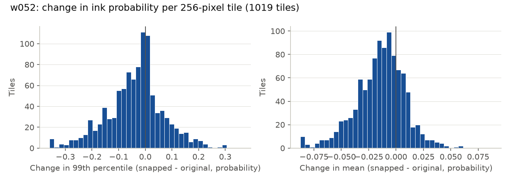
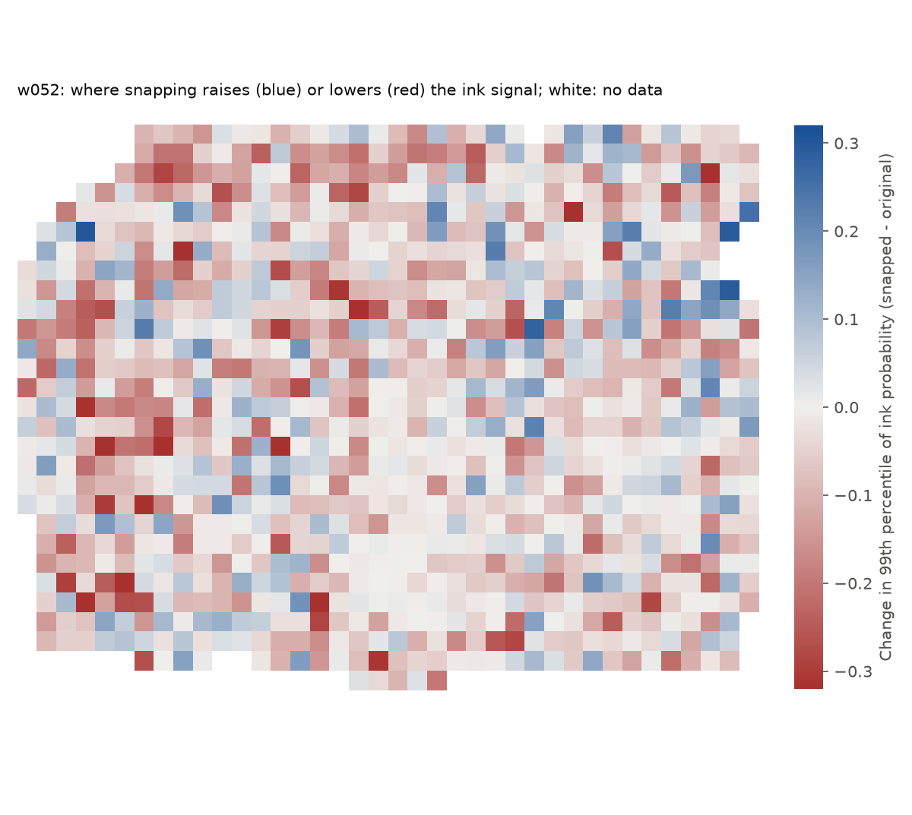
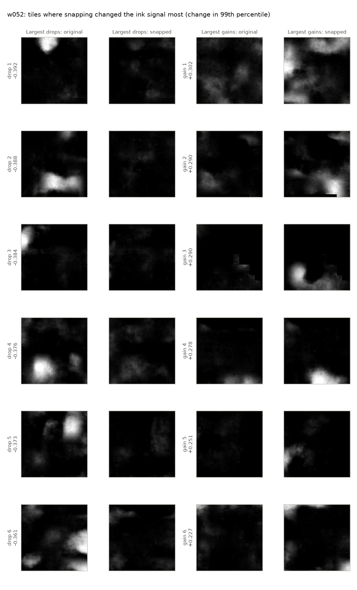

# Ink-detection test: snapping made the ink less legible

This test was pre-registered in [`ink_test_plan.md`](ink_test_plan.md), which was pushed before any surface volume was rendered and before the ink model was run on a snapped mesh. The plan's run log records how the run went. It ran on 3 November 2026 on one Windows PC, CPU only. The data files behind every number here are in [`ink_test/`](ink_test/).

## Summary

- **Primary outcome, w052 (held out): snapping hurts.**
  - In a blind review of 60 pairs of ink-map crops, the map from the original mesh was preferred 75 times and the map from the snapped mesh 31 times.
  - That is 29% for the snapped map (95% CI 21–39%), with a two-sided exact sign test p = 2.3 × 10⁻⁵.
  - Each of the two reviewers alone points the same way.
- **Secondary outcome, w035 against its ink labels:** the snapped map scores lower, with AUC 0.998 → 0.995 and best F1 0.969 → 0.950. The model was trained on w035, with labels drawn on the original mesh. So, as the plan says, this is not conclusive on its own, but it points the same way.
- **Where it changes: all over.**
  - On w052, about half of the 256-pixel tiles lose more than 0.02 of their 99th-percentile ink probability, and a quarter gain as much.
  - The change doesn't follow how far the mesh moved or how much of it was flagged (|ρ| < 0.11 throughout).
- **The snapped mesh does sit on a density edge more often.** One voxel either side of the face, it has gap outside and papyrus inside at 42% of w052's pixels, against 22% for the original. That is close to what the snapper optimises, so it shows the snapper works as built. A surface on that edge is evidently not what this ink model needs.
- **Seed 43**, the second checkpoint, gives the same picture.
- **The follow-up on PHerc. 0841** is in [`ink_test_0841.md`](ink_test_0841.md).
  - On three traced segments, snapping made no detectable difference to agreement with the ink labels.
  - On KLAVIS's spiral-fit windings, the drop-in output was about even and the dense output lost ground.

## Primary outcome: blind legibility review (w052)

The review set, its sealed key and both reviewers' answers are in [`ink_review.md`](ink_review.md), with how to check them. Each item showed the two ink maps side by side, with nothing else. The question was "which shows the ink more clearly?"

| Reviewer | Snapped preferred | Original preferred | About the same | Can't tell | Snapped share of decisive answers (95% CI) | Sign test p | Catch items right |
|---|---|---|---|---|---|---|---|
| The repository owner | 18 | 37 | 5 | 0 | 33% (22–46%) | 0.014 | 8 of 8 |
| Someone who hadn't worked on the tool | 13 | 38 | 9 | 0 | 25% (16–39%) | 0.0006 | 8 of 8 |
| **Pooled** | **31** | **75** | 14 | 0 | **29% (21–39%)** | **2.3 × 10⁻⁵** | |

The 10 controls were random places with no ink condition.
- **The repository owner:** snapped 2, original 3, about the same 3, can't tell 2.
- **The other reviewer:** snapped 2, original 6, about the same 2.

## Secondary outcome: agreement with the w035 ink labels

This is scored on 1,071,121 pixels inside the supervision mask (31% ink). Every pixel is valid in both renders and non-zero in the map from the official surface volume.

| Map | AUC, seed 42 | Best F1, seed 42 | AUC, seed 43 | Best F1, seed 43 |
|---|---|---|---|---|
| Official surface volume | 0.9991 | 0.978 | | |
| Our render, original mesh | 0.9979 | 0.969 | 0.9973 | 0.964 |
| Our render, snapped mesh | 0.9949 | 0.950 | 0.9926 | 0.939 |
| **Snapped − original** | **−0.0030** | **−0.019** | **−0.0047** | **−0.025** |

w035 is biased toward the original mesh: the labels were drawn on a render of it, and the model was trained on them. So a lower score for the snapped mesh is not conclusive, as the plan says. It goes the same way as the primary outcome.

## Descriptive: where does it change?

The unit is a 256 × 256-pixel tile with at least half its pixels valid. "Flagged" samples are those of the dense snapped mesh marked reversed-face or at the search limit.

| | w052, seed 42 | w052, seed 43 | w035, seed 42 | w035, seed 43 |
|---|---|---|---|---|
| Tiles | 1019 | 1019 | 384 | 384 |
| Median change in the tile mean | −0.012 | −0.013 | −0.013 | −0.014 |
| Median change in the tile 99th percentile | −0.027 | −0.027 | −0.012 | −0.018 |
| Tiles losing / gaining more than 0.02 (99th percentile) | 53% / 24% | 52% / 24% | 45% / 24% | 47% / 18% |
| Whole-map mean probability, original → snapped | 0.319 → 0.305 | 0.322 → 0.305 | 0.323 → 0.308 | 0.329 → 0.312 |
| Spearman ρ of the 99th-percentile change with mean \|shift\| | +0.06 (p = 0.07) | −0.04 (p = 0.19) | −0.05 (p = 0.36) | −0.03 (p = 0.61) |
| Spearman ρ of the 99th-percentile change with the flagged share | +0.07 (p = 0.04) | −0.07 (p = 0.04) | −0.10 (p = 0.04) | −0.04 (p = 0.43) |

The correlations of the change in the tile mean are as small (|ρ| ≤ 0.10). Some notes on reading this:
- **The tiles differ little in how far they moved.** The middle half of w052's tiles have a mean |shift| of 1.50–1.90 voxels and 12–24% flagged samples. So this can't rule out that moving further hurts more. What it does show is that the loss isn't confined to a few badly snapped places.
- **The probability scale is narrow.** The model was trained with label smoothing, so its probabilities run from about 0.25 to 0.75. A change of 0.02 in the 99th percentile is about 4% of that range.
- **A check after the fact, by ink level.** Ranking tiles by the mean of both maps' 99th percentiles, 56–72% of tiles lose signal in every quartile. So the loss is not limited to inky tiles or to blank ones. Ranking by the original map alone would seem to show gains in blank tiles, but that is regression to the mean.

In the tiles that lose most, whole ink blobs in the original map are gone in the snapped one. In the tiles that gain most, blobs appear that the original doesn't show.

The w035 figures are in [`ink_test/`](ink_test/).

## Sanity check

Our w035 map from the original mesh was compared with the map from the official surface volume. The Pearson r is 0.862 over 25.2 million pixels, with a mean absolute difference of 0.039. This fits the renderer check, where our render matched the official volume layer by layer with a mean correlation of 0.932.

## The mesh one and two voxels from the face

This check was added after a suggestion by Sean in the Vesuvius Challenge Discord; it is not part of the plan.

`tools/face_step_check.py` reads each render D voxels outside and D voxels inside the recto face, at the mesh's own face offset. That offset is +1.25 voxels on w052 and +0.50 on w035. The scan is thresholded with Otsu's method, pooled over both renders. These are shares of all valid pixels:

| | Gap outside | Papyrus inside | Both | Brighter inside than outside |
|---|---|---|---|---|
| w052, 1 voxel: original → snapped | 53% → 68% | 59% → 70% | 22% → 42% | 59% → 81% |
| w052, 2 voxels | 56% → 71% | 65% → 82% | 36% → 59% | 63% → 83% |
| w035, 1 voxel | 56% → 71% | 49% → 65% | 21% → 42% | 54% → 77% |
| w035, 2 voxels | 59% → 77% | 51% → 73% | 32% → 58% | 55% → 80% |

The snapper puts the steepest edge at the mesh's own offset, which is close to what this measures, so the gain is expected. It shows that the snapper does what it is built to do. It doesn't show that the snapped surface is where the ink is, and the review says it is not better for reading.

## What this means

- **Don't use snapped meshes for ink detection**, at least with `ink_9um` and the default settings and drop-in output tested here.
- **Why it hurts is not known.** Two candidates, neither tested:
  - The model was trained on renders of traced meshes. It may depend on how those sit relative to the papyrus, so moving the surface, even onto an edge, moves the ink away from where the model expects it.
  - The steepest density edge may not be where the ink is.
- **A direct check would be cheap:** render the original mesh at uniform offsets of a few voxels either way, and see how strongly the ink signal depends on depth.
