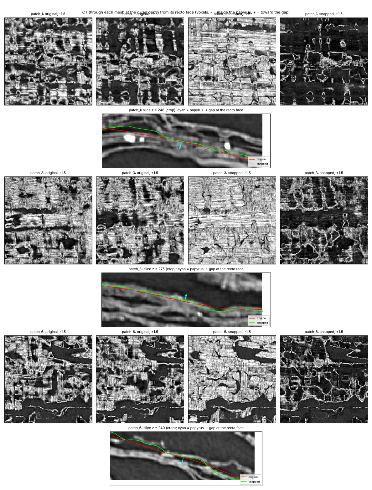
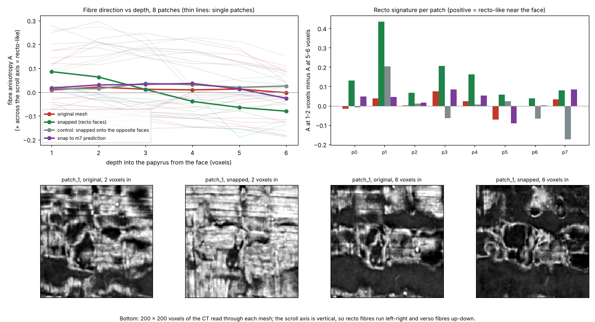

# Mesh snapping on a VC3D segment: w035 (PHerc. 0139, 9.362 µm)

The same snapper, applied to a traced VC3D surface (tifxyz) instead of voxel labels. The segment is the one used in the scrollprize.org ink-detection tutorial:
- **Segment:** `PHerc0139/segments/20260317000000-w035_2026031718/mesh/20260317000000-on-20250728140407-9.362um.tifxyz`. It is a grid of 291 × 262 vertices about 20 voxels apart.
- **Scan:** `PHerc0139/volumes/20250728140407-9.362um-1.2m-113keV-masked.zarr`, full resolution.

Both are in the Vesuvius Challenge open-data bucket. `tools/fetch_segment.py` downloaded the whole segment, plus the scan around 8 random patches of it. The seed was 0. Each patch is 24 × 24 vertices, about 460 × 460 voxels of surface, with a 24-voxel margin.

## How meshes are snapped

`scroll_label_snap/mesh.py` reuses the label pipeline's scores and graph cut (`core.solve_surface`). Four things are specific to meshes:

1. **Densifying the mesh.** It is resampled bilinearly 7× (to about 2.9 voxels between samples) and solved at that resolution, with grid neighbours as graph neighbours. A 20-voxel grid cannot follow the sheet between its vertices.
2. **Orientation.** Normals come from the grid itself, so they agree along the whole mesh. Which side is recto comes from the scroll's geometry: every wrap's recto faces the scroll centre.
   - A circle fit to the whole segment puts the scroll axis near (y 3523, x 3182).
   - The grid normal points away from that axis at 100% of vertices, so papyrus → gap at the recto face is the flipped grid normal.
   - The CT alone could not decide this here. A local vote agreed with itself at only 52–63% of samples per patch, and picked the wrong side in 3 of the 8 patches.
3. **Convention.** The mesh keeps its own offset from the papyrus face. The offset is estimated per patch and comes out 0 to +1.5 voxels: the face is at most 1.5 voxels toward the gap from the mesh. The median shift applied to the original mesh is 0 in 6 of the 8 patches and ±0.5 voxel in the other two.
4. **Output.** There are two outputs:
   - **The snapped dense surface.**
   - **The original grid with each vertex moved,** so that the bilinear mesh best matches the snapped surface in a least-squares sense. This one is a drop-in replacement for the input.

## Where the original mesh sits

Each mesh is read at its own typical face position. The question is whether the CT is brighter 2 voxels on the papyrus side than 2 voxels on the gap side.

| | Papyrus on the recto side | Mean step across the face |
|---|---|---|
| Original mesh | 55% | 8.4 |
| Snapped mesh | 88% | 60.4 |

At the voxel level, the traced surface is about as often on the wrong side of a face as the right one. This matches the 2026 open problems note that traced segments drift across fibre layers rather than tracking one sheet. The comparison is partly circular, because the snapper's own score rewards a clear face. The drift test below is not circular.



The figure shows three patches. In each:
- **Top row:** the CT read through the original and the snapped mesh, 1.5 voxels inside the recto face and 1.5 voxels outside it.
- **Bottom row:** a cross-section with both meshes traced on it.

After snapping, the layer just inside the face is papyrus almost everywhere, with fibres visible. The layer just outside is gap. The original mesh shows a patchwork of both at either depth.

## Drift test (8 patches, 15,324 trusted samples)

This follows the same protocol as for labels:
- **The drift.** Each mesh was pushed off the surface by a known smooth random drift, applied to its vertices along their normals. The drift was zero-median, so the mesh's convention does not change.
- **The runs.** Each method was run on the drifted mesh. We measured how far the result lands from the original mesh, along the original normals.
- **Where it is scored.** Only at **trusted samples**, where the original mesh sits on a strong, unambiguous recto face. There the original can serve as ground truth.

We used two drift settings:
- std 1.5 voxels, correlation length 40 voxels. This is the setting used for labels. The 20-voxel grid smooths it, so the realized drift is smaller.
- std 2.0 voxels, correlation length 80 voxels. The grid can carry this one.

| Method | std 1.5, corr. 40: mean error | within 1 voxel | over 2 | std 2.0, corr. 80: mean error | within 1 voxel | over 2 |
|---|---|---|---|---|---|---|
| No correction (drifted mesh) | 0.78 | 70% | 5% | 1.37 | 42% | 27% |
| VC3D alpha-composite refiner, default thresholds | 10.84 | 5% | 88% | 10.73 | 4% | 89% |
| same, median offset removed | 6.79 | 10% | 81% | 6.74 | 10% | 82% |
| same, thresholds tuned on these patches (50 and 110 of 255), offset removed | 0.91 | 61% | 6% | 1.01 | 57% | 10% |
| **Snapper** | **0.51** | **90%** | **2%** | **0.54** | **90%** | **2%** |

The refiner is a Python port of VC3D's `ObjAlphaCompRefinement`. Its default opacity thresholds (118 and 165 of 255) are above most of this scan's papyrus, so the table also gives it its most generous setting: thresholds picked by grid search on these same patches, plus removing its median offset. Even then it does worse than no correction.

**Consistency.** This is measured at all 210k samples. It asks whether snapping the drifted mesh lands where snapping the original lands.

| | std 1.5, corr. 40 | std 2.0, corr. 80 |
|---|---|---|
| Snapper | 84% | 75% |
| Refiner | 62% | 51% |

Per-patch numbers are in [`eval_mesh_w035.json`](eval_mesh_w035.json) and [`eval_mesh_w035_drift80.json`](eval_mesh_w035_drift80.json).

## Fibre check: does the snapper land on recto faces?

A papyrus sheet is two fibre layers. The recto layer faces the scroll centre, and its fibres run horizontally, around the scroll. The verso layer's fibres run vertically, along the scroll's axis. This gives a test that the snapper's own scores never look at.

Read the CT through a surface at increasing depth into the papyrus from its face:
- **On a recto face,** fibres near the face should run across the scroll axis, then turn toward the axis deeper in.
- **On a verso face,** the pattern should reverse.
- **For a surface that wanders between layers,** it should blur out.

`tools/fibre_check.py` measures texture direction in the surface, relative to the scan's z axis. It uses a structure tensor on papyrus pixels away from gaps. The anisotropy A is positive when fibres run across the axis (recto-like). Per mesh, the summary is A at 1–2 voxels in minus A at 5–6 voxels in. This difference is positive for the recto pattern, and it cancels any per-patch bias in A.

For a control, the same patches were also snapped onto the opposite faces: `--normals grid`, which makes the snapper treat the outward side as the gap.

| Surface | Near minus deep (mean over 8 patches) | Positive in |
|---|---|---|
| Original mesh | +0.010 | 5 of 8 |
| Snapped onto recto-polarity faces (default) | **+0.147** | **8 of 8** |
| Control: snapped onto the opposite faces | −0.009 | 4 of 8 |



The snapped surface shows the recto pattern in every patch. The original mesh and the control do not. The effect is consistent, but small in absolute terms: near the face, both fibre directions are visible.

What this does and doesn't show:
- **It shows** the snapper's faces are recto faces, not the inner faces of verso layers, which is the likely mix-up within ±4 voxels when sheets are about 8 voxels thick.
- **It can't show** whether a recto face belongs to the sheet the tracer meant, or to the next sheet's recto.

Per-patch numbers are in [`fibre_w035.json`](fibre_w035.json). The texture windows in the figure are from patch_1, the clearest of the 8. The curves cover all 8.

## Review flags

The snapper marks two kinds of place:
- **At the search limit:** 15% of dense samples stop at ±4 voxels, so the face may be farther away. These are written to the `snap_limit` channel.
- **Reversed face:** 10.5% sit on a face of the opposite polarity, as for labels. These are written to `snap_flag`.

Together these cover 23% of the dense surface. On the input-size grid, `snap_review` marks the 17% of vertices where most of the surrounding surface is flagged. That points a reviewer at about a fifth of the mesh rather than all of it.

A wider search range (`--param t_max=6`) cuts the samples at the limit to about 6%. But the fibre pattern gets slightly weaker (+0.138, positive in 7 of 8 patches), so ±4 stays the default.

## How much the original mesh moves, and the open question

The snapper moves the original mesh a lot: a mean of 1.96 voxels, and 78% of samples by at least 1 voxel. The shifts are spread fairly evenly over the ±4-voxel search range:
- 30% of samples move by 3 voxels or more;
- 15% stop at the ±4 limit.

10% of samples are flagged as sitting on a face of the opposite polarity.

At this resolution, the sheets in these patches are thin (about 8 voxels) and often packed into bundles of thinner layers. The original trace often runs through the middle of a bundle. Where it does, there is more than one recto-polarity face within reach. The snapper takes the nearest one that fits smoothly with its neighbours, and that may be a neighbouring thin layer rather than the one the tracer meant.

The drift test only shows that the snapper keeps a mesh that already sits on a clear face, and brings a drifted one back to it. The fibre check adds that the faces it picks are recto faces. Neither can say which sheet's recto a wandering trace should follow where two lie within reach. That needs an expert eye, or a downstream check such as ink detection on renders of the original and the snapped mesh.

## Held-out test and comparison with snapping onto the m7 prediction

A held-out segment was set out before download: w052, 8 patches, seed 0, default settings. Its results are in [`mesh_w052.md`](mesh_w052.md). It does at least as well as w035 on every measure. For example, the drift test within 1 voxel is 94% vs 90%, and the fibre check is 8 of 8 patches again.

The same file compares the snapper with snapping onto the organisers' m7 surface prediction, the method of Erwin Nieuwlaar's PHerc. 343 First Letters meshes. That comparison was run on both segments. The w035 evaluation files here were regenerated with the extended tool. The numbers reported above are unchanged.

## Reproduce

```
python tools/fetch_segment.py segments/w035 \
    --segment https://vesuvius-challenge-open-data.s3.amazonaws.com/PHerc0139/segments/20260317000000-w035_2026031718/mesh/20260317000000-on-20250728140407-9.362um.tifxyz/ \
    --volume https://vesuvius-challenge-open-data.s3.amazonaws.com/PHerc0139/volumes/20250728140407-9.362um-1.2m-113keV-masked.zarr/ \
    --patches 8 --patch 24 --seed 0
python tools/snap_tifxyz.py snapped segments/w035/patch_*
python tools/eval_mesh.py results/eval_mesh_w035.json segments/w035/patch_*
python tools/eval_mesh.py results/eval_mesh_w035_drift80.json segments/w035/patch_* --drift-std 2 --drift-corr 80
python tools/render_mesh.py results/mesh_w035_render.png snapped segments/w035/patch_1 segments/w035/patch_3 segments/w035/patch_6 --sections
python tools/snap_tifxyz.py snapped_opposite segments/w035/patch_* --normals grid      # control for the fibre check
python tools/snap_to_prediction.py snapped_m7 segments/w035/patch_*                    # needs --extra m7=... in the fetch
python tools/fibre_check.py results/fibre_w035.json segments/w035/patch_* --snapped snapped --control snapped_opposite \
    --compare "snap to m7 prediction=snapped_m7" --png results/fibre_w035.png --show patch_1
```

The fetch needs `pip install "zarr>=2.16,<3" fsspec aiohttp requests`. The patches total about 400 MB.
