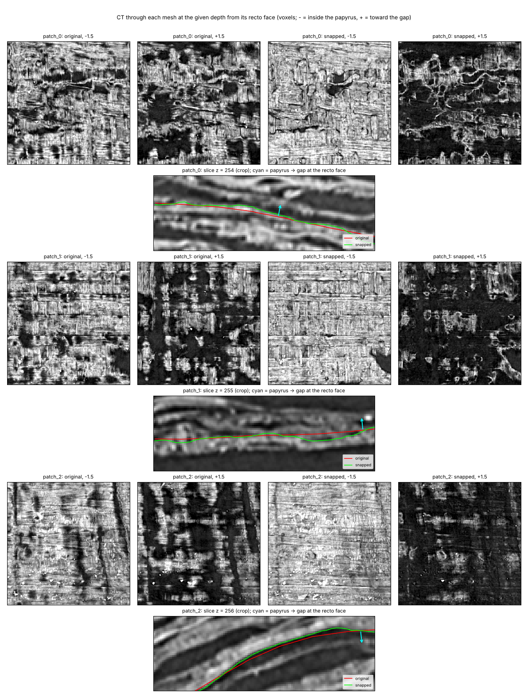
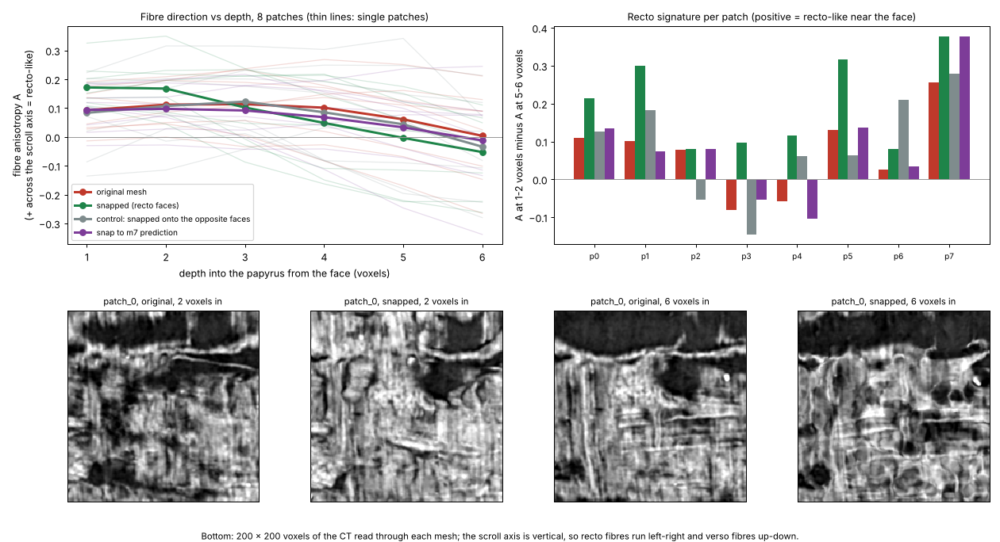

# Mesh snapping, held-out test: segment w052 (PHerc. 0139, 9.362 µm)

This is the held-out test for mesh snapping. It was set out in commit `daf4b81` before any w052 data was downloaded:
- **Segment:** w052, a different wrap from the w035 development segment, on the same scan.
  - Path: `PHerc0139/segments/20260227000000-w052_2026022705/mesh/20260227000000-on-20250728140407-9.362um.tifxyz`.
  - It is a grid of 385 × 488 vertices, 89% valid.
- **Patches:** 8 random patches of 24 × 24 vertices, seed 0.
- **Settings:** the default settings, with nothing tuned.

**Orientation.** This comes from the segment's own curvature:
- The fitted scroll axis is at (y 3441, x 3137).
- The w035 fit gave (y 3523, x 3182), about 90 voxels away.
- The recto side is against the grid normal at 99.4% of vertices.

## Results (pre-registered measures)

| | w052, held out | w035, development |
|---|---|---|
| Papyrus on the recto side of the face: original → snapped | 70% → **93%** | 55% → 88% |
| Mean CT step across the face: original → snapped | 30.2 → 75.3 | 8.4 → 60.4 |
| Drift test (std 1.5, corr. 40), within 1 voxel: no correction | 69% | 70% |
| same: VC3D refiner, thresholds tuned on these patches, offset removed | 68% | 61% |
| same: VC3D refiner, thresholds from each patch's levels, offset removed (added later) | 70% | 57% |
| same: **snapper** | **94%** | 90% |
| Drift test (std 2, corr. 80), within 1 voxel: no correction | 41% | 42% |
| same: VC3D refiner, tuned, offset removed | 64% | 57% |
| same: VC3D refiner, each patch's levels, offset removed (added later) | 66% | 55% |
| same: **snapper** | **92%** | 90% |
| Consistency, std 1.5 drift: snapper / refiner (default) / refiner (each patch's levels) | 90% / 66% / 84% | 84% / 62% / 75% |
| Fibre check, recto signature: snapped | **+0.198, 8 of 8 patches** | +0.147, 8 of 8 |
| same: original mesh | +0.070, 6 of 8 | +0.010, 5 of 8 |
| same: control snapped onto the opposite faces | +0.091, 6 of 8 | −0.009, 4 of 8 |
| Samples at the ±4-voxel search limit / on a reversed face | 8.8% / 7.2% | 15% / 10.5% |
| Vertices marked for review (`snap_review`) | 9.7% | 17% |

The drift tests use 24,689 trusted samples on w052 and 15,324 on w035. The VC3D refiner with its default thresholds gets 7% and 6% within 1 voxel on w052 (5% and 4% on w035).

The held-out segment comes out at least as well as the development one, on every measure. The w052 trace starts closer to the papyrus face than w035 (70% vs 55% on the recto side), and the snapper still moves 71% of its samples by at least 1 voxel. The median signed move is 0 to 0.5 voxels, so the mesh keeps its depth convention.



The figure shows the first three patches. They were not chosen.



## Compared with snapping onto the m7 surface prediction (added after the w035 results)

Erwin Nieuwlaar won the PHerc. 343 First Letters prize by snapping his meshes onto the organisers' m7 surface prediction ([`mesh/snap_meshes.py`](https://github.com/Nieuwlaar/pherc343-first-letters)). The PHerc. 306B winners reused that snap step on 40 windings. The open-data bucket has the m7 prediction for this scan, so we cropped it around the same patches:
- the m7 prediction: `PHerc0139/representations/predictions/surfaces/20250728140407-surface-20260413222639-surface-m7-L0-th0.2.zarr`;
- a separate recto-surface prediction: `.../20250728140407-surface-20250701154204-surface-recto-090.zarr`.

`scroll_label_snap/baselines.py` ports his snap step with his defaults. It searches ±15 voxels for the nearest predicted sheet, rejects offsets more than 6 voxels from their neighbourhood, and smooths with σ = 1 cell. `tools/snap_to_prediction.py` runs it on the patches.

This comparison was not part of the pre-registered test. It was run on both segments.

| | w052 | w035 |
|---|---|---|
| Drift test (std 1.5, corr. 40), within 1 voxel: snap to m7, median offset removed | 63% | 41% |
| same: snapper | **94%** | **90%** |
| Drift test (std 2, corr. 80), within 1 voxel: snap to m7, offset removed | 57% | 40% |
| same: snapper | **92%** | **90%** |
| Consistency (std 1.5): snap to m7 / snapper | 76% / **90%** | 69% / **84%** |
| Fibre check, recto signature: snap to m7 / snapper | +0.085, 6 of 8 / **+0.198, 8 of 8** | +0.030, 7 of 8 / **+0.147, 8 of 8** |
| Papyrus 1–2 voxels inside the face: original / snap to m7 / snapper | 68% / 68% / **89%** | 56% / 59% / **81%** |
| Recto-surface prediction within 2 voxels: original / snapper / snap to m7 | 92% / 93% / 96% | 86% / 90% / 94% |

How to read this:
- **Drift test.** Its ground truth is where the original mesh sits on a clear face in the CT, so it favours a method that aims at the CT face. Snapping to the prediction aims at the prediction's centre instead, and part of its error is the local difference between the two.
- **Consistency and the fibre check** also reward landing on a CT edge. A per-sample search with no graph cut gets 93% consistency on w052 (snapper 90%) and a fibre score of +0.19, 8 of 8 patches (snapper +0.20). So these rows compare CT-edge methods with a prediction-based one. They don't show that the snapper is more accurate than snapping to m7.
- **Recto-surface prediction.** This is a different model from m7, but it marks similar bands. It favours snapping onto m7.
  - All three meshes lie on or next to the predicted recto surface almost everywhere.
  - The snapper does not move meshes off it: 86% → 90% on w035 and 92% → 93% on w052.
- **Rendering.** The prediction-snapped mesh leaves the papyrus just inside its face as patchy as the original.
- **The two tools work differently.** His tool moves the 20-voxel grid's vertices, and in his pipeline it is followed by flattening. Ours solves at about 3-voxel spacing and fits the grid back by least squares.

One more data point, from the PHerc. 306B winners. After snapping to m7, they found that "snapping the surface to CT density peaks gave no improvement" in the legibility of their letters (their `docs/METHOD.md`). So a cleaner surface does not by itself promise better ink. That still has to be measured.

## Reproduce

```
python tools/fetch_segment.py segments/w052 \
    --segment https://vesuvius-challenge-open-data.s3.amazonaws.com/PHerc0139/segments/20260227000000-w052_2026022705/mesh/20260227000000-on-20250728140407-9.362um.tifxyz/ \
    --volume https://vesuvius-challenge-open-data.s3.amazonaws.com/PHerc0139/volumes/20250728140407-9.362um-1.2m-113keV-masked.zarr/ \
    --patches 8 --patch 24 --seed 0 \
    --extra m7=https://vesuvius-challenge-open-data.s3.amazonaws.com/PHerc0139/representations/predictions/surfaces/20250728140407-surface-20260413222639-surface-m7-L0-th0.2.zarr/ \
    --extra recto=https://vesuvius-challenge-open-data.s3.amazonaws.com/PHerc0139/representations/predictions/surfaces/20250728140407-surface-20250701154204-surface-recto-090.zarr/
python tools/snap_tifxyz.py snapped segments/w052/patch_*
python tools/snap_tifxyz.py snapped_opposite segments/w052/patch_* --normals grid
python tools/snap_to_prediction.py snapped_m7 segments/w052/patch_*
python tools/eval_mesh.py results/eval_mesh_w052.json segments/w052/patch_*
python tools/eval_mesh.py results/eval_mesh_w052_drift80.json segments/w052/patch_* --drift-std 2 --drift-corr 80
python tools/fibre_check.py results/fibre_w052.json segments/w052/patch_* --snapped snapped --control snapped_opposite \
    --compare "snap to m7 prediction=snapped_m7" --png results/fibre_w052.png
python tools/render_mesh.py results/mesh_w052_render.png snapped segments/w052/patch_0 segments/w052/patch_1 segments/w052/patch_2 --sections
```

`eval_mesh.py` runs the m7 comparison and the recto-prediction check whenever `m7.tif` and `recto.tif` are in the patch folders. The pre-registered numbers above came from the first run, before the predictions were downloaded. The final run reproduced them exactly.
