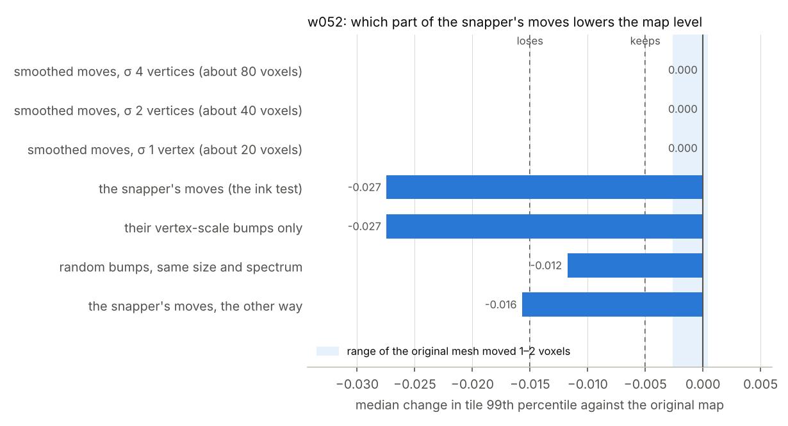

# Diagnostic 2: the snapper's vertex-scale bumps lower the map level; its smoothed moves don't

This was planned in [`move_scale_plan.md`](move_scale_plan.md), pushed at 53ccfc2 before any of these meshes was rendered. It ran on 3–4 November 2026 with the ink test's renderer, model (`ink_9um` seed 42), settings and layer direction. The score files are in [`move_scale/`](move_scale/).

The measure is the ink map's level, tile by tile: how strong the map is. The plan calls it the ink signal. It is not a measure of legibility, so whether a mesh reads better or worse still needs a blind review.

## Summary

- **The whole drop is in the vertex-scale bumps.**
  - With only the bumps (the moves minus their part smoothed at σ = 2 vertices), the median tile change is −0.027, and 52% of tiles lose more than 0.02. That is the same as the full snap: −0.027 and 53%.
  - With only the smoothed part, at any of the three scales, the median tile change is 0.000. Tiles lose and gain about equally (23–31%), as when the original mesh is moved 1–2 voxels.
  - By the rule fixed in advance: lp2 keeps the map level and hp2 lowers it, so the cost is in the moves' roughness at scales under about 40 voxels. None of the smoothed meshes lowers it, not even the one smoothed at σ = 1 vertex (about 20 voxels).
- **The snapper's bumps lower it more than random ones.**
  - Random bumps with the same spread and spatial spectrum gave −0.012, with 43% of tiles losing. That is within 0.005 of the mirrored mesh (−0.016).
  - By the rule fixed in advance, random bumps cost what the mirrored ones did, and the snapper's own bumps cost more than chance.
- **The smoothed snap keeps part of the geometric gain.**
  - One voxel either side of the face, we count the pixels with gap outside and papyrus inside: 22% for the original mesh, 42% for the snapped one, and 31% for the snap smoothed at σ = 1 vertex.
  - So that smoothing keeps 43% of the gain, with no drop in map level.
- **A candidate:** snap, then smooth the moves over about one vertex spacing. Whether that reads better than the original needs a new blind review. Neither is started.

## Each mesh against the original map

There are 66,398,659 pixels valid in all eight renders, in 1019 tiles. "Move sd" and "neighbour r" describe the moves of the vertices, along their normals.

| Mesh | Move sd (voxels) | Neighbour r | r with the original map | Whole-map mean | Median tile change (99th percentile) | Tiles losing / gaining more than 0.02 |
|---|---|---|---|---|---|---|
| Original | | | 1 | 0.319 | | |
| Original moved 1–2 voxels (the depth diagnostic) | uniform | 1 | 0.84–0.94 | 0.318–0.319 | 0.000 to −0.003 | 27–37% / 26–32% |
| lp4: smoothed, σ = 4 vertices | 0.67 | 0.99 | 0.954 | 0.319 | 0.000 | 24% / 23% |
| lp2: smoothed, σ = 2 vertices | 0.93 | 0.97 | 0.937 | 0.319 | 0.000 | 24% / 25% |
| lp1: smoothed, σ = 1 vertex | 1.33 | 0.88 | 0.897 | 0.318 | 0.000 | 31% / 29% |
| **Snapped** (the ink test) | 2.39 | 0.47 | 0.714 | 0.305 | **−0.027** | 53% / 24% |
| **hp2: the bumps only** | 2.03 | 0.29 | 0.732 | 0.306 | **−0.027** | 52% / 24% |
| rand: random bumps, same spectrum | 2.39 | 0.46 | 0.692 | 0.312 | −0.012 | 43% / 32% |
| **Mirrored** | 2.39 | 0.47 | 0.684 | 0.310 | **−0.016** | 47% / 29% |

## The face-step check

This is one voxel either side of the face, at w052's face offset (+1.25 voxels), with the scan thresholded by Otsu's method over all eight renders. The shares are of every valid pixel.

| Mesh | Gap outside | Papyrus inside | Both | Brighter inside than outside |
|---|---|---|---|---|
| Original | 53% | 59% | 22% | 59% |
| lp4 | 55% | 60% | 25% | 63% |
| lp2 | 56% | 62% | 27% | 65% |
| lp1 | 60% | 64% | 31% | 71% |
| **Snapped** | 68% | 70% | 42% | 81% |
| hp2 | 61% | 64% | 31% | 73% |
| rand | 50% | 58% | 20% | 55% |
| Mirrored | 48% | 54% | 16% | 50% |

The snapper's gain on this check splits about evenly between its smoothed moves and its bumps: both lp1 and hp2 reach 31%. As before, this check is close to what the snapper optimises, so it shows where the mesh sits, not that it reads better.

## What this means

- **What lowers the map level is the bumpiness of the drop-in output.** Its moves vary from one vertex to the next: neighbours 20 voxels apart move with a correlation of only 0.47. The model tolerates the same moves smoothed over about 20 voxels, and it tolerates uniform shifts of 2 voxels.
- **The snapper's bumps are not just noise.** They cost more than random bumps of the same size and spectrum, or than the same bumps the other way. So they are tied to the scan in a way that weakens this model's maps. Why is not tested here.
- **Where the bumps come from:** the drop-in output is fitted from a dense snap that follows the scan at about 3-voxel detail.
- **Not started:** a smooth-snap option, and a pre-registered blind review of it against the original.
