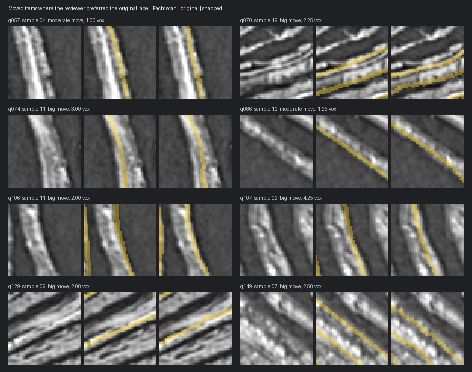

# Blind review v1: set 32989576ca01

- **Reviewer:** the repository owner, on 2 Nov 2026: 154 items in about 18 minutes, using `review/index.html`.
- **Set:** built by `tools/make_review.py --seed 0` from the 20 cubes in `results/eval_v1.md`.
- **Blinding:** the answer key was sealed before the review started; its SHA-256 is in the README and in commit c0fd638. The key is now `review_v1_key.json`, the encrypted copy is `review/sealed_key_32989576ca01.enc`, and the passphrase is `9604d528887255046369be4837558f7be416c4c8323c4a5c`.
- **Answers:** `review_v1_answers.json`, exported from the review page's database. Item q066 was answered twice; the second answer is kept.
- **Scoring:** `python tools/score_review.py results/review_v1_key.json results/review_v1_answers.json`.

### Blind review: which label sits on the papyrus surface?

| Group | Items | Snapped preferred | Original preferred | Same | Can't tell | Snapped share of decisive (95% CI) | Sign test p |
|---|---|---|---|---|---|---|---|
| big move | 60 | 47 (78%) | 6 (10%) | 3 (5%) | 4 (7%) | 89% (77-95%) | 5.81e-09 |
| moderate move | 60 | 51 (85%) | 2 (3%) | 2 (3%) | 5 (8%) | 96% (87-99%) | 3.18e-13 |
| all moved items | 120 | 98 (82%) | 8 (7%) | 5 (4%) | 9 (8%) | 92% (86-96%) | 8.08e-21 |
| hazy cubes (2, 8, 17, 18) | 24 | 20 (83%) | 1 (4%) | 0 (0%) | 3 (12%) | 95% (77-99%) | 2.1e-05 |
| other cubes | 96 | 78 (81%) | 7 (7%) | 5 (5%) | 6 (6%) | 92% (84-96%) | 2.8e-16 |
| label moved with +normal (delta > 0) | 62 | 48 (77%) | 6 (10%) | 2 (3%) | 6 (10%) | 89% (78-95%) | 3.26e-09 |
| label moved with -normal (delta < 0) | 58 | 50 (86%) | 2 (3%) | 3 (5%) | 3 (5%) | 96% (87-99%) | 6.12e-13 |

Controls (snapped and original agree within 0.25 voxel at the item's centre; the rest of the window can differ): 2 of 20 rated the same; 18 got a preference (18 snapped, 0 original), 0 can't tell.
Catch items (original vs. the original pushed off the surface): original chosen in 9 of 14; pushed into the gap (+3.0): 5 of 8; pushed into the sheet (-2.5): 4 of 6.
Left/right: A chosen in 65 and B in 70 of the decisive answers (each candidate was A in exactly half the items).
Answer time: median 4.6 s; 0 answers under 1 s.
Answered 154 of 154 items (set 32989576ca01).

### Per cube (moved items only)

| Cube | Items | Snapped | Original | Same | Can't tell |
|---|---|---|---|---|---|
| sample_00001 | 6 | 6 | 0 | 0 | 0 |
| sample_00002 (hazy) | 6 | 4 | 1 | 0 | 1 |
| sample_00003 | 6 | 5 | 0 | 0 | 1 |
| sample_00004 | 6 | 5 | 1 | 0 | 0 |
| sample_00005 | 6 | 5 | 0 | 0 | 1 |
| sample_00006 | 6 | 6 | 0 | 0 | 0 |
| sample_00007 | 6 | 4 | 1 | 0 | 1 |
| sample_00008 (hazy) | 6 | 5 | 0 | 0 | 1 |
| sample_00009 | 6 | 5 | 1 | 0 | 0 |
| sample_00010 | 6 | 6 | 0 | 0 | 0 |
| sample_00011 | 6 | 2 | 2 | 2 | 0 |
| sample_00012 | 6 | 4 | 1 | 1 | 0 |
| sample_00013 | 6 | 5 | 0 | 1 | 0 |
| sample_00014 | 6 | 5 | 0 | 0 | 1 |
| sample_00015 | 6 | 6 | 0 | 0 | 0 |
| sample_00016 | 6 | 6 | 0 | 0 | 0 |
| sample_00017 (hazy) | 6 | 6 | 0 | 0 | 0 |
| sample_00018 (hazy) | 6 | 5 | 0 | 0 | 1 |
| sample_00019 | 6 | 4 | 1 | 0 | 1 |
| sample_00020 | 6 | 4 | 0 | 1 | 1 |

## Caveats

- **The reviewer isn't independent.** They own this repository.
- **It isn't fully blind in practice.** The snapped label often has a visible stair-step edge, a side effect of how `warp_labels` moves the band. A reviewer could sometimes tell which candidate is the snapped one.
- **The controls weren't true controls.** They were chosen where the snapper didn't move the label at the item's centre point. Across the whole 48 x 48 window, though, the two labels overlap with a median IoU of only 0.39, about the same as the moderate-move items (0.35).
  - The two controls whose windows were nearly identical (IoU 0.86 and 0.79) were rated "about the same".
  - The other 18 all went to the snapped label.
- **The catch items have the same weakness.** The original is known to be right only at the centre point.
  - In the two catch items where the pushed label was chosen (q002 and q006), the original disagrees with the snapped label over most of the window (IoU 0.19 and 0.20).
  - In both, the pushed label agrees with the snapped label slightly more (IoU 0.23 and 0.24).
  - Counting only decisive catch answers, the original won 9 of 11.
- **Coverage is limited.** Each item is one slice, and there was one reviewer.

## Where the snapper lost

There were 8 moved items where the original won.
- In 5 of them (q074, q106, q107, q129, q149) the snapped label sits inside the sheet rather than on its face. In thick sheets this is plausibly the seam between the two fibre layers.
- The rest are small moves of 1-1.25 voxels (q057, q086) and one stair-stepped band in a dense stack (q070).
