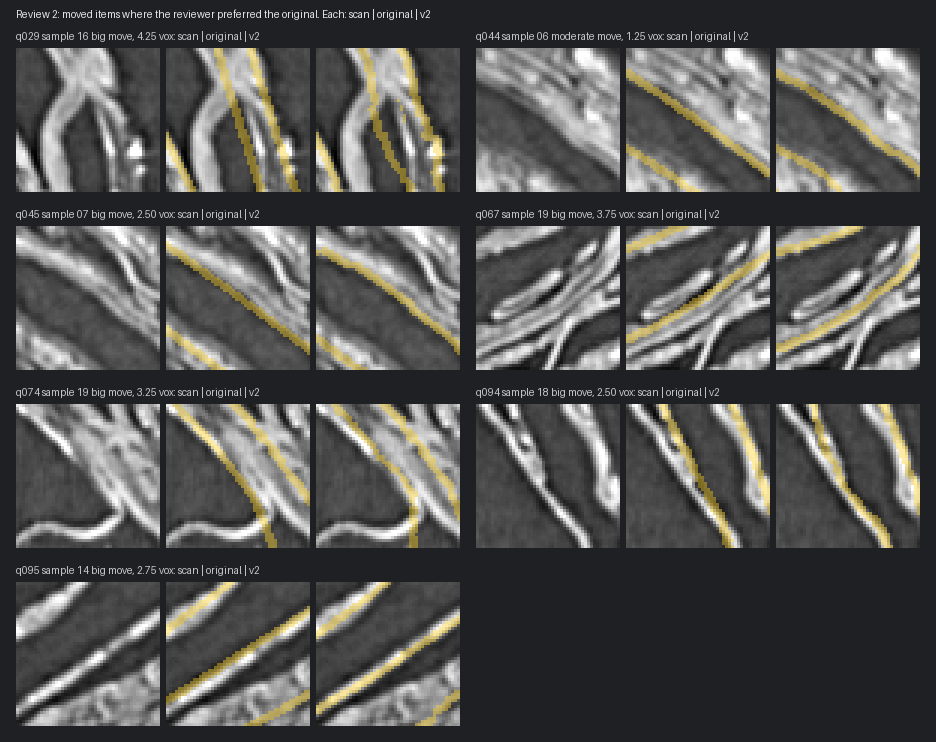

# Blind review v2: set af7d4c85d7f6

- **Reviewer:** a second person who did not work on the tool and had not seen these scans before. Reviewed 2 Nov 2026 using `review/v2/index.html`: instructions, 4 practice items and 111 items in about 11 minutes.
- **Labels compared:** the original labels against the **v2** snapper (smooth warp and inside-the-sheet guard). Built by `tools/make_review_v2.py --seed 1`. No item is within 32 voxels of a v1 review item.
- **Practice:** 4 of 4 right (`review_v2_practice.json`).
- **Blinding:** the answer key was sealed before the review started. Its SHA-256 is in the README and in commit 2a42d9b. The key is now `review_v2_key.json`, the encrypted copy is `review/sealed_key_af7d4c85d7f6.enc`, and the passphrase is `2c6d1e288757f47cfdbae74e8394d6b16fa2bef18ca0f8ae`.
- **Answers:** `review_v2_answers.json`, exported from the review page's database. No answer was changed.
- **Scoring:** `python tools/score_review.py results/review_v2_key.json results/review_v2_answers.json`.

### Blind review: which label sits on the papyrus surface?

| Group | Items | Snapped preferred | Original preferred | Same | Can't tell | Snapped share of decisive (95% CI) | Sign test p |
|---|---|---|---|---|---|---|---|
| big move | 40 | 27 (68%) | 6 (15%) | 0 (0%) | 7 (18%) | 82% (66-91%) | 0.000324 |
| moderate move | 40 | 36 (90%) | 1 (2%) | 1 (2%) | 2 (5%) | 97% (86-100%) | 5.53e-10 |
| all moved items | 80 | 63 (79%) | 7 (9%) | 1 (1%) | 9 (11%) | 90% (81-95%) | 2.28e-12 |
| hazy cubes (2, 8, 17, 18) | 16 | 12 (75%) | 1 (6%) | 0 (0%) | 3 (19%) | 92% (67-99%) | 0.00342 |
| other cubes | 64 | 51 (80%) | 6 (9%) | 1 (2%) | 6 (9%) | 89% (79-95%) | 5.68e-10 |
| label moved with +normal (delta > 0) | 46 | 37 (80%) | 3 (7%) | 0 (0%) | 6 (13%) | 92% (80-97%) | 1.95e-08 |
| label moved with -normal (delta < 0) | 34 | 26 (76%) | 4 (12%) | 1 (3%) | 3 (9%) | 87% (70-95%) | 5.95e-05 |

Controls (the two labels agree across the whole window, IoU 0.80-0.95): 11 of 15 rated the same; 4 got a preference (3 snapped, 1 original), 0 can't tell.
Catch items (original vs. the original pushed off the surface): original chosen in 16 of 16; pushed into the gap (+3.0): 8 of 8; pushed into the sheet (-2.5): 8 of 8.
Left/right: A chosen in 44 and B in 46 of the decisive answers (each candidate was A in exactly half the items).
Answer time: median 3.7 s; 0 answers under 1 s.
Answered 111 of 111 items (set af7d4c85d7f6).

### Per cube (moved items only)

| Cube | Items | Snapped | Original | Same | Can't tell |
|---|---|---|---|---|---|
| sample_00001 | 4 | 4 | 0 | 0 | 0 |
| sample_00002 (hazy) | 4 | 2 | 0 | 0 | 2 |
| sample_00003 | 4 | 4 | 0 | 0 | 0 |
| sample_00004 | 4 | 3 | 0 | 0 | 1 |
| sample_00005 | 4 | 3 | 0 | 0 | 1 |
| sample_00006 | 4 | 2 | 1 | 0 | 1 |
| sample_00007 | 4 | 3 | 1 | 0 | 0 |
| sample_00008 (hazy) | 4 | 4 | 0 | 0 | 0 |
| sample_00009 | 4 | 4 | 0 | 0 | 0 |
| sample_00010 | 4 | 3 | 0 | 0 | 1 |
| sample_00011 | 4 | 3 | 0 | 1 | 0 |
| sample_00012 | 4 | 2 | 0 | 0 | 2 |
| sample_00013 | 4 | 4 | 0 | 0 | 0 |
| sample_00014 | 4 | 3 | 1 | 0 | 0 |
| sample_00015 | 4 | 4 | 0 | 0 | 0 |
| sample_00016 | 4 | 3 | 1 | 0 | 0 |
| sample_00017 (hazy) | 4 | 3 | 0 | 0 | 1 |
| sample_00018 (hazy) | 4 | 3 | 1 | 0 | 0 |
| sample_00019 | 4 | 2 | 2 | 0 | 0 |
| sample_00020 | 4 | 4 | 0 | 0 | 0 |

## How this compares with review v1

| | Review v1 | Review v2 |
|---|---|---|
| Reviewer | repo owner | independent, new to the scans |
| Snapper version | v1 | v2 |
| Moved items, snapped preferred of decisive answers | 98 of 106 (92%) | 63 of 70 (90%) |
| Big moves (2+ voxels) | 47-6 | 27-6 |
| Moderate moves (1-2 voxels) | 51-2 | 36-1 |
| Hazy cubes 2, 8, 17, 18 | 20-1 | 12-1 |
| Controls rated "about the same" | not real controls | 11 of 15 |
| Catch items right | 9 of 14 | 16 of 16 |

## Caveats

- **Still one reviewer per set.** Each review comes from a single person, judging single slices.
- **The reviewer isn't a stranger or an expert.** She is someone the repo owner knows, not a scroll specialist. The page told her only that the bands come from different methods, mixed at random.
- **The controls tested only for bias.** They show the reviewer doesn't invent differences: 11 of 15 were rated the same, and the other 4 split 3 to 1. They don't test the snapper.

## Where the snapper lost

There were 7 losses: 6 big moves and 1 moderate move.
- **The known failure mode (4 losses: q029, q067, q074, q095).** These are the failure mode found in review v1: the original label sits on a face whose gap is on the opposite side from the oriented normal. The v2 guard didn't stop them. Three of them are outward moves it should have caught, and one is an inward move, which the guard doesn't cover.
- **The other 3 (q044, q045, q094)** are inward moves of 1.25-2.5 voxels where the normal agrees with the scan.
