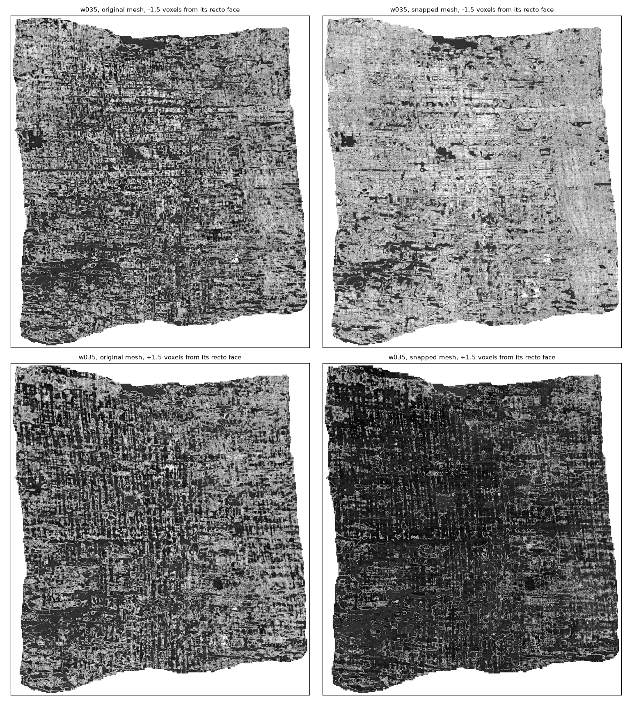

# Whole segment: w035 snapped tile by tile

Segment w035 of PHerc. 0139 (9.362 µm), the one in the scrollprize.org ink tutorial, snapped in full with `tools/snap_segment.py` at its defaults. The 8 patches in [`mesh_w035.md`](mesh_w035.md) come from this segment; this run covers all of it.

| | |
|---|---|
| Grid | 291 × 262 vertices, densified 7× to 3.1 million samples |
| Tiles | 279 tiles of 24 × 24 vertices, overlapping by 4 and blended; none failed |
| Time | 7 minutes on Lysander with 8 workers, reading the scan from the open-data bucket as it went (12 GB of chunks, cached for reruns and the render) |
| Offset | one for the whole segment: +0.5 voxels, the median of 12 sample tiles (range 0 to +1.5) |
| Moves | mean 1.9 voxels; 74% of samples moved by 1 voxel or more |
| Review flags | 11.0% of samples on a reversed face, 15.7% at the ±4-voxel search limit; `snap_review` marks 17.7% of vertices (the 8 patches: 10.5%, 15% and 17%) |

**Papyrus on the recto side of the face.** Read from the renders below, at 1.5 voxels inside and outside each mesh's recto face, over 12.3 million pixels:

| | Original mesh | Snapped mesh |
|---|---|---|
| Inside the face brighter than outside | 54% | **86%** |
| Mean brightness inside / outside (of 255) | 113 / 100 | 157 / 62 |

On the 8 patches the same measure was 55% → 88%, so the patches were representative. Both meshes are rendered on the same pixel grid with the same intensity window. Pixels clipped to black at both depths in either mesh are left out, since they can't be told apart from the area outside the mesh.

**No seams.** The blended shift field is as smooth across tile boundaries as inside tiles. Between neighbouring samples, the shift changes by a median 0.23 voxels across a tile boundary and 0.17–0.19 voxels elsewhere. The 99th percentile is 1.0 voxel in both.



Top: 1.5 voxels inside the papyrus from each mesh's recto face. Bottom: 1.5 voxels toward the gap. Through the snapped mesh, the inside reads as papyrus nearly everywhere, with the recto's horizontal fibres showing. The outside reads as gap. Through the original, both are mixed.

The run summary is [`w035_whole_snap_segment.json`](w035_whole_snap_segment.json) (per-tile logs left out). The snapped segment itself is not in the repository: it is derived from CC BY-NC data, and `snap_segment.py` reproduces it.

```bash
python tools/snap_segment.py out/w035_whole \
  --segment https://vesuvius-challenge-open-data.s3.amazonaws.com/PHerc0139/segments/20260317000000-w035_2026031718/mesh/20260317000000-on-20250728140407-9.362um.tifxyz/ \
  --volume https://vesuvius-challenge-open-data.s3.amazonaws.com/PHerc0139/volumes/20250728140407-9.362um-1.2m-113keV-masked.zarr/ \
  --cache zarr_cache --workers 8 --name w035
python tools/render_segment.py out/w035_whole/w035 out/w035_whole --volume <same URL> --cache zarr_cache --workers 8
```
